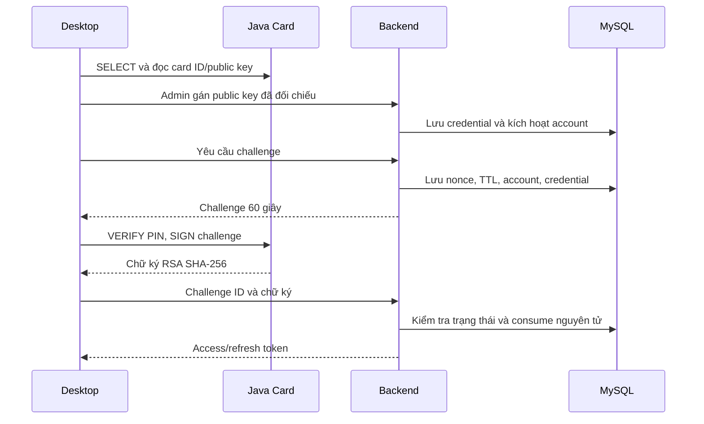

# Kiến trúc và trách nhiệm file

## Backend

Module: `identity`, `account`, `credential`, `rbac`, `client`, `auth`, `session`, `policy`, `audit`, `management`.

| Thư mục | Trách nhiệm |
|---|---|
| `controller` | Mapping HTTP, validate DTO, lấy principal; không SQL hoặc nghiệp vụ |
| `dto` | Request/response của API; không dùng entity làm HTTP input |
| `service` | Điều phối use case, trạng thái, transaction, quy tắc bảo mật |
| `repository` | JPA repositories và truy vấn JDBC aggregate; SQL ở đây |
| `entity` | 41 entity JPA ánh xạ schema; không trả trực tiếp qua HTTP |
| `initializer` | Bootstrap lần đầu; không phục vụ endpoint công khai |
| `security` | Xác minh JWT, phiên, authority, key custody, filter |
| `shared` | Error handling, UTC time, helper persistence nội bộ |

Các module chưa có nghiệp vụ triển khai chỉ chứa entity/repository; không tạo controller/service giả trả thành công.

JPA và JDBC dùng cùng datasource/transaction manager. JPA entity dùng để kiểm tra mapping schema và CRUD chuẩn; truy vấn nhiều bảng, consume nguyên tử và thao tác khóa dùng JDBC trong repository. Không đặt SQL trong service/controller. Không expose Spring Data REST.

`ManagementService/ManagementRepository` là công cụ lab dành cho authority `idp.manage`, có catalog allowlist, phân trang, redaction trường bí mật và chỉ cho sửa 17 nhóm cấu hình. Token/session/credential/audit/challenge không được ghi tùy ý qua generic CRUD. Các quy trình nhạy cảm đi qua API chuyên biệt. Đây không phải sự thay thế cho API nghiệp vụ chi tiết của toàn bộ SRS.

## Frontend

| File/package | Trách nhiệm |
|---|---|
| `DesktopApplication` | Khởi chạy ứng dụng trên Swing EDT, thiết lập giao diện |
| `ui/IdpWindow` | Khung cửa sổ, trạng thái view, task runner, tiện ích hiển thị |
| `ui/ScreenFactory` | Dựng các màn hình và gắn action |
| `ui/IdpController` | Xử lý thao tác người dùng, dialog và cập nhật view |
| `api/IdpApi` | HTTP, JSON, bearer header, refresh token và lỗi API |
| `service/SmartCardAuthenticationService` | Điều phối đọc thẻ → challenge → ký → verify |
| `card/CardTransport` | Hợp đồng truyền APDU |
| `card/PcscTransport` | Socket provider của simulator hoặc PC/SC thật |
| `card/CardClient` | APDU protocol, status word, đọc public key, PIN và ký |
| `card-applet` | Private key và PIN bên trong Java Card; không nằm trên BE |

## Luồng tin cậy

Việc gán public key là một thao tác quản trị có xác minh danh tính/fingerprint ngoài kênh. Card ID, ATR hoặc UID không đủ để xác thực. Simulator không chứng minh khóa nằm trong phần cứng đáng tin cậy. Không gắn nhãn AAL2 cho luồng lab này.
