# KMA IdP — UML Class Diagram (Domain Model)

Sơ đồ lớp (Class Diagram) dưới đây được chuyển đổi từ mô hình ERD 32 bảng theo hướng **Rich Domain Model (DDD)**: ánh xạ kiểu dữ liệu sang kiểu hướng đối tượng (`Long`, `String`, `Instant`, `LocalDate`, `byte[]`), phân biệt quan hệ **Composition (`*--`)** cho các thực thể phụ thuộc vòng đời với **Association (`-->`)** giữa các Aggregate, và bổ sung các phương thức nghiệp vụ cốt lõi.

```mermaid
classDiagram

    %% =================================================
    %% A. IDENTITY AND ORGANIZATION MANAGEMENT
    %% =================================================

    class Organization {
        +Long id
        +Long parentId
        +String orgCode
        +String orgName
        +String orgType
        +String description
        +String status
        +Instant createdAt
        +Instant updatedAt
        +isActive() Boolean
    }

    class Person {
        +Long id
        +String personCode
        +String displayName
        +String email
        +String phone
        +LocalDate dateOfBirth
        +String status
        +Instant createdAt
        +Instant updatedAt
    }

    class Identity {
        +Long id
        +Long personId
        +String subjectId
        +String identityType
        +String status
        +Instant createdAt
        +Instant updatedAt
        +isActive() Boolean
    }

    class OrgMembership {
        +Long id
        +Long identityId
        +Long organizationId
        +String membershipType
        +String status
        +LocalDate joinedAt
        +LocalDate endedAt
        +Instant createdAt
        +isEffectiveOn(LocalDate date) Boolean
    }

    class Account {
        +Long id
        +Long identityId
        +String username
        +String accountType
        +String status
        +Boolean isLocked
        +Instant lockedUntil
        +Instant lastLoginAt
        +Instant createdAt
        +Instant updatedAt
        +lock(Instant until) void
        +unlock() void
        +isCurrentlyLocked(Instant now) Boolean
        +recordLogin(Instant at) void
    }

    class ExternalIdentity {
        +Long id
        +Long identityId
        +String issuer
        +String externalSubject
        +String provider
        +Instant linkedAt
    }

    %% =================================================
    %% B. CREDENTIAL & WEBAUTHN / PASSKEY MANAGEMENT
    %% =================================================

    class Credential {
        +Long id
        +Long accountId
        +String credentialType
        +String credentialName
        +String credentialIdentifier
        +String secretHash
        +String secretReference
        +String certificateFingerprint
        +String status
        +Instant registeredAt
        +Instant lastUsedAt
        +Instant expiresAt
        +revoke() void
        +isExpired(Instant now) Boolean
        +markUsed(Instant at) void
    }

    class WebAuthnCredential {
        +Long credentialId
        +String webauthnCredentialId
        +String userHandle
        +String rpId
        +byte[] publicKeyCose
        +Integer coseAlgorithm
        +Long signCount
        +String aaguid
        +List~String~ transports
        +Boolean backupEligible
        +Boolean backupState
        +String attestationFormat
        +verifyAndAdvanceCounter(Long newCount) Boolean
    }

    class WebAuthnChallenge {
        +Long id
        +Long accountId
        +String challenge
        +String ceremonyType
        +String rpId
        +String userVerification
        +Instant expiresAt
        +Instant consumedAt
        +Instant createdAt
        +isValid(Instant now) Boolean
        +consume(Instant now) void
    }

    %% =================================================
    %% C. ORGANIZATION BUSINESS ROLES
    %% =================================================

    class OrgRole {
        +Long id
        +String roleCode
        +String roleName
        +String description
        +Boolean isActive
    }

    class OrgRoleAssignment {
        +Long id
        +Long membershipId
        +Long orgRoleId
        +Long assignedBy
        +Instant validFrom
        +Instant validUntil
        +String status
        +isEffective(Instant now) Boolean
    }

    %% =================================================
    %% D. DYNAMIC RBAC
    %% =================================================

    class Role {
        +Long id
        +String roleCode
        +String roleName
        +String description
        +Boolean isSystem
        +Boolean isActive
        +Instant createdAt
        +Instant updatedAt
    }

    class Permission {
        +Long id
        +String permissionCode
        +String resource
        +String action
        +String description
        +Boolean isActive
    }

    class RolePermission {
        +Long id
        +Long roleId
        +Long permissionId
        +Instant createdAt
    }

    class AccountRoleAssignment {
        +Long id
        +Long accountId
        +Long roleId
        +Long organizationId
        +Long applicationId
        +Long assignedBy
        +Instant validFrom
        +Instant validUntil
        +String status
        +Instant createdAt
        +isEffective(Instant now) Boolean
    }

    %% =================================================
    %% E. APPLICATION CLIENT MANAGEMENT
    %% =================================================

    class Application {
        +Long id
        +Long organizationId
        +String clientId
        +String clientName
        +String clientType
        +String protocol
        +String clientAuthMethod
        +Boolean requirePkce
        +String status
        +Instant createdAt
        +Instant updatedAt
        +supportsGrant(String grantType) Boolean
        +isAllowedRedirectUri(String uri) Boolean
    }

    class ClientRedirectUri {
        +Long id
        +Long applicationId
        +String redirectUri
        +Boolean isActive
        +Instant createdAt
    }

    class ClientLogoutUri {
        +Long id
        +Long applicationId
        +String postLogoutRedirectUri
        +Boolean isActive
    }

    class ClientCredential {
        +Long id
        +Long applicationId
        +String credentialType
        +String credentialName
        +String secretHash
        +String secretReference
        +String publicKey
        +String certificateFingerprint
        +Instant expiresAt
        +Instant revokedAt
        +String status
        +Instant createdAt
        +revoke(Instant now) void
    }

    class OidcScope {
        +Long id
        +String scopeName
        +String description
        +Boolean isStandard
        +Boolean isActive
    }

    class ApplicationScope {
        +Long id
        +Long applicationId
        +Long scopeId
        +Boolean isDefault
        +Boolean isRequired
        +String status
    }

    class ClientGrantType {
        +Long id
        +Long applicationId
        +String grantType
        +Boolean isEnabled
    }

    %% =================================================
    %% F. AUTHENTICATION, OIDC AND FEDERATION
    %% =================================================

    class IdpSession {
        +Long id
        +Long accountId
        +String sessionIdHash
        +String status
        +Instant authenticatedAt
        +Instant lastActivityAt
        +Instant expiresAt
        +Instant revokedAt
        +touch(Instant now) void
        +revoke(Instant now) void
        +isActive(Instant now) Boolean
    }

    class SessionClient {
        +Long id
        +Long sessionId
        +Long applicationId
        +Instant joinedAt
        +Instant loggedOutAt
        +markLoggedOut(Instant now) void
    }

    class AuthenticationEvent {
        +Long id
        +Long identityId
        +Long accountId
        +Long applicationId
        +Long credentialId
        +String authenticationMethod
        +String eventType
        +String result
        +String ipAddress
        +String userAgent
        +Instant createdAt
    }

    class AuthorizationCode {
        +Long id
        +Long applicationId
        +Long sessionId
        +String codeHash
        +String redirectUri
        +String nonce
        +String codeChallenge
        +String codeChallengeMethod
        +Instant expiresAt
        +Instant consumedAt
        +Instant createdAt
        +verifyPkce(String codeVerifier) Boolean
        +consume(Instant now) void
    }

    class AuthorizationCodeScope {
        +Long id
        +Long authorizationCodeId
        +Long scopeId
    }

    class RefreshToken {
        +Long id
        +Long accountId
        +Long applicationId
        +Long sessionId
        +String tokenHash
        +String familyId
        +String status
        +Instant issuedAt
        +Instant expiresAt
        +Instant revokedAt
        +revoke(Instant now) void
        +isUsable(Instant now) Boolean
    }

    class UserConsent {
        +Long id
        +Long identityId
        +Long applicationId
        +String status
        +Instant grantedAt
        +Instant revokedAt
        +revoke(Instant now) void
    }

    class UserConsentScope {
        +Long id
        +Long userConsentId
        +Long scopeId
        +Instant grantedAt
    }

    %% =================================================
    %% G. SECURITY AND AUDIT
    %% =================================================

    class SecurityPolicy {
        +Long id
        +Long organizationId
        +Long applicationId
        +String policyType
        +String policyName
        +String policyConfigJson
        +String status
        +Long updatedBy
        +Instant updatedAt
    }

    class AuditLog {
        +Long id
        +Long actorAccountId
        +String eventType
        +String action
        +String resourceType
        +String resourceId
        +String result
        +String ipAddress
        +String metadataJson
        +Instant createdAt
    }

    %% =================================================
    %% RELATIONSHIPS (COMPOSITION & ASSOCIATION)
    %% =================================================

    Organization "0..1" o-- "0..*" Organization : parentChild
    Organization "1" --> "0..*" OrgMembership : includes
    Identity "1" --> "0..*" OrgMembership : participates

    Person "1" --> "0..*" Identity : owns
    Identity "1" --> "0..*" Account : has
    Account "1" *-- "0..*" Credential : owns
    Credential "1" *-- "0..1" WebAuthnCredential : webAuthnDetails
    Account "0..1" --> "0..*" WebAuthnChallenge : initiates
    Identity "1" *-- "0..*" ExternalIdentity : links

    OrgMembership "1" *-- "0..*" OrgRoleAssignment : receives
    OrgRole "1" --> "0..*" OrgRoleAssignment : assignedAs
    Account "0..1" --> "0..*" OrgRoleAssignment : assignedBy

    Role "1" *-- "0..*" RolePermission : contains
    Permission "1" --> "0..*" RolePermission : includedIn

    Account "1" *-- "0..*" AccountRoleAssignment : receives
    Role "1" --> "0..*" AccountRoleAssignment : assignedAs
    Organization "0..1" --> "0..*" AccountRoleAssignment : scopedTo
    Application "0..1" --> "0..*" AccountRoleAssignment : scopedTo
    Account "0..1" --> "0..*" AccountRoleAssignment : assignedBy

    Organization "0..1" --> "0..*" Application : owns
    Application "1" *-- "0..*" ClientRedirectUri : configures
    Application "1" *-- "0..*" ClientLogoutUri : configures
    Application "1" *-- "0..*" ClientCredential : owns
    Application "1" *-- "0..*" ApplicationScope : allows
    OidcScope "1" --> "0..*" ApplicationScope : configuredFor
    Application "1" *-- "0..*" ClientGrantType : supports

    Account "1" --> "0..*" IdpSession : creates
    IdpSession "1" *-- "0..*" SessionClient : tracks
    Application "1" --> "0..*" SessionClient : joins

    Identity "1" --> "0..*" AuthenticationEvent : generates
    Account "1" --> "0..*" AuthenticationEvent : authenticates
    Application "0..1" --> "0..*" AuthenticationEvent : initiates
    Credential "0..1" --> "0..*" AuthenticationEvent : uses

    Application "1" --> "0..*" AuthorizationCode : issues
    IdpSession "1" --> "0..*" AuthorizationCode : authorizes
    AuthorizationCode "1" *-- "1..*" AuthorizationCodeScope : grants
    OidcScope "1" --> "0..*" AuthorizationCodeScope : includedIn

    Account "1" --> "0..*" RefreshToken : owns
    Application "1" --> "0..*" RefreshToken : issues
    IdpSession "1" --> "0..*" RefreshToken : associatedWith

    Identity "1" --> "0..*" UserConsent : grants
    Application "1" --> "0..*" UserConsent : receives
    UserConsent "1" *-- "1..*" UserConsentScope : includes
    OidcScope "1" --> "0..*" UserConsentScope : grantedScope

    Organization "0..1" --> "0..*" SecurityPolicy : applies
    Application "0..1" --> "0..*" SecurityPolicy : applies
    Account "0..1" --> "0..*" SecurityPolicy : updatedBy

    Account "0..1" --> "0..*" AuditLog : performs
```

