# KMA IdP — Entity Relationship Diagram (Phiên bản Hoàn chỉnh)

Tài liệu này chứa sơ đồ **Entity Relationship Diagram (ERD)** tổng thể cho hệ thống **KMA IdP (Identity Provider & OIDC SSO)** gồm 32 bảng, đã được hợp nhất các tinh chỉnh về phân tách chứng thực theo tài khoản (`ACCOUNT ||--o{ CREDENTIAL`), hỗ trợ đầy đủ **Passkey / WebAuthn (`WEBAUTHN_CREDENTIAL`, `WEBAUTHN_CHALLENGE`)**, **OIDC Authorization Code + PKCE (`AUTHORIZATION_CODE_SCOPE`, `nonce`)**, và **Single Logout (`SESSION_CLIENT`)**.

```mermaid
erDiagram

    %% =================================================
    %% A. IDENTITY AND ORGANIZATION MANAGEMENT
    %% =================================================

    ORGANIZATION {
        bigint id PK
        bigint parent_id FK
        varchar org_code UK
        varchar org_name
        varchar org_type
        varchar description
        varchar status
        timestamp created_at
        timestamp updated_at
    }

    PERSON {
        bigint id PK
        varchar person_code UK
        varchar display_name
        varchar email
        varchar phone
        date date_of_birth
        varchar status
        timestamp created_at
        timestamp updated_at
    }

    IDENTITY {
        bigint id PK
        bigint person_id FK
        varchar subject_id UK
        varchar identity_type
        varchar status
        timestamp created_at
        timestamp updated_at
    }

    ORG_MEMBERSHIP {
        bigint id PK
        bigint identity_id FK
        bigint organization_id FK
        varchar membership_type
        varchar status
        date joined_at
        date ended_at
        timestamp created_at
    }

    ACCOUNT {
        bigint id PK
        bigint identity_id FK
        varchar username UK
        varchar account_type
        varchar status
        boolean is_locked
        timestamp locked_until
        timestamp last_login_at
        timestamp created_at
        timestamp updated_at
    }

    EXTERNAL_IDENTITY {
        bigint id PK
        bigint identity_id FK
        varchar issuer
        varchar external_subject
        varchar provider
        timestamp linked_at
    }

    %% =================================================
    %% B. CREDENTIAL & WEBAUTHN / PASSKEY MANAGEMENT
    %% =================================================

    CREDENTIAL {
        bigint id PK
        bigint account_id FK
        varchar credential_type
        varchar credential_name
        varchar credential_identifier
        varchar secret_hash
        varchar secret_reference
        varchar certificate_fingerprint
        varchar status
        timestamp registered_at
        timestamp last_used_at
        timestamp expires_at
    }

    WEBAUTHN_CREDENTIAL {
        bigint credential_id PK,FK
        varchar webauthn_credential_id UK
        varchar user_handle
        varchar rp_id
        blob public_key_cose
        int cose_algorithm
        bigint sign_count
        char aaguid
        json transports
        boolean backup_eligible
        boolean backup_state
        varchar attestation_format
    }

    WEBAUTHN_CHALLENGE {
        bigint id PK
        bigint account_id FK
        varchar challenge UK
        varchar ceremony_type
        varchar rp_id
        varchar user_verification
        timestamp expires_at
        timestamp consumed_at
        timestamp created_at
    }

    %% =================================================
    %% C. ORGANIZATION BUSINESS ROLES
    %% =================================================

    ORG_ROLE {
        bigint id PK
        varchar role_code UK
        varchar role_name
        varchar description
        boolean is_active
    }

    ORG_ROLE_ASSIGNMENT {
        bigint id PK
        bigint membership_id FK
        bigint org_role_id FK
        bigint assigned_by FK
        timestamp valid_from
        timestamp valid_until
        varchar status
    }

    %% =================================================
    %% D. DYNAMIC RBAC
    %% =================================================

    ROLE {
        bigint id PK
        varchar role_code UK
        varchar role_name
        varchar description
        boolean is_system
        boolean is_active
        timestamp created_at
        timestamp updated_at
    }

    PERMISSION {
        bigint id PK
        varchar permission_code UK
        varchar resource
        varchar action
        varchar description
        boolean is_active
    }

    ROLE_PERMISSION {
        bigint id PK
        bigint role_id FK
        bigint permission_id FK
        timestamp created_at
    }

    ACCOUNT_ROLE_ASSIGNMENT {
        bigint id PK
        bigint account_id FK
        bigint role_id FK
        bigint organization_id FK
        bigint application_id FK
        bigint assigned_by FK
        timestamp valid_from
        timestamp valid_until
        varchar status
        timestamp created_at
    }

    %% =================================================
    %% E. APPLICATION CLIENT MANAGEMENT
    %% =================================================

    APPLICATION {
        bigint id PK
        bigint organization_id FK
        varchar client_id UK
        varchar client_name
        varchar client_type
        varchar protocol
        varchar client_auth_method
        boolean require_pkce
        varchar status
        timestamp created_at
        timestamp updated_at
    }

    CLIENT_REDIRECT_URI {
        bigint id PK
        bigint application_id FK
        varchar redirect_uri
        boolean is_active
        timestamp created_at
    }

    CLIENT_LOGOUT_URI {
        bigint id PK
        bigint application_id FK
        varchar post_logout_redirect_uri
        boolean is_active
    }

    CLIENT_CREDENTIAL {
        bigint id PK
        bigint application_id FK
        varchar credential_type
        varchar credential_name
        varchar secret_hash
        varchar secret_reference
        text public_key
        varchar certificate_fingerprint
        timestamp expires_at
        timestamp revoked_at
        varchar status
        timestamp created_at
    }

    OIDC_SCOPE {
        bigint id PK
        varchar scope_name UK
        varchar description
        boolean is_standard
        boolean is_active
    }

    APPLICATION_SCOPE {
        bigint id PK
        bigint application_id FK
        bigint scope_id FK
        boolean is_default
        boolean is_required
        varchar status
    }

    CLIENT_GRANT_TYPE {
        bigint id PK
        bigint application_id FK
        varchar grant_type
        boolean is_enabled
    }

    %% =================================================
    %% F. AUTHENTICATION, OIDC AND FEDERATION
    %% =================================================

    IDP_SESSION {
        bigint id PK
        bigint account_id FK
        varchar session_id_hash UK
        varchar status
        timestamp authenticated_at
        timestamp last_activity_at
        timestamp expires_at
        timestamp revoked_at
    }

    SESSION_CLIENT {
        bigint id PK
        bigint session_id FK
        bigint application_id FK
        timestamp joined_at
        timestamp logged_out_at
    }

    AUTHENTICATION_EVENT {
        bigint id PK
        bigint identity_id FK
        bigint account_id FK
        bigint application_id FK
        bigint credential_id FK
        varchar authentication_method
        varchar event_type
        varchar result
        varchar ip_address
        varchar user_agent
        timestamp created_at
    }

    AUTHORIZATION_CODE {
        bigint id PK
        bigint application_id FK
        bigint session_id FK
        varchar code_hash UK
        varchar redirect_uri
        varchar nonce
        varchar code_challenge
        varchar code_challenge_method
        timestamp expires_at
        timestamp consumed_at
        timestamp created_at
    }

    AUTHORIZATION_CODE_SCOPE {
        bigint id PK
        bigint authorization_code_id FK
        bigint scope_id FK
    }

    REFRESH_TOKEN {
        bigint id PK
        bigint account_id FK
        bigint application_id FK
        bigint session_id FK
        varchar token_hash UK
        varchar family_id
        varchar status
        timestamp issued_at
        timestamp expires_at
        timestamp revoked_at
    }

    USER_CONSENT {
        bigint id PK
        bigint identity_id FK
        bigint application_id FK
        varchar status
        timestamp granted_at
        timestamp revoked_at
    }

    USER_CONSENT_SCOPE {
        bigint id PK
        bigint user_consent_id FK
        bigint scope_id FK
        timestamp granted_at
    }

    %% =================================================
    %% G. SECURITY AND AUDIT
    %% =================================================

    SECURITY_POLICY {
        bigint id PK
        bigint organization_id FK
        bigint application_id FK
        varchar policy_type
        varchar policy_name
        json policy_config
        varchar status
        bigint updated_by FK
        timestamp updated_at
    }

    AUDIT_LOG {
        bigint id PK
        bigint actor_account_id FK
        varchar event_type
        varchar action
        varchar resource_type
        varchar resource_id
        varchar result
        varchar ip_address
        json metadata
        timestamp created_at
    }

    %% =================================================
    %% RELATIONSHIPS
    %% =================================================

    ORGANIZATION o|--o{ ORGANIZATION : parent_child
    ORGANIZATION ||--o{ ORG_MEMBERSHIP : has
    IDENTITY ||--o{ ORG_MEMBERSHIP : participates

    PERSON ||--o{ IDENTITY : owns
    IDENTITY ||--o{ ACCOUNT : has
    ACCOUNT ||--o{ CREDENTIAL : owns
    CREDENTIAL ||--o| WEBAUTHN_CREDENTIAL : details
    ACCOUNT o|--o{ WEBAUTHN_CHALLENGE : initiates
    IDENTITY ||--o{ EXTERNAL_IDENTITY : links

    ORG_MEMBERSHIP ||--o{ ORG_ROLE_ASSIGNMENT : receives
    ORG_ROLE ||--o{ ORG_ROLE_ASSIGNMENT : assigned_as
    ACCOUNT o|--o{ ORG_ROLE_ASSIGNMENT : assigned_by

    ROLE ||--o{ ROLE_PERMISSION : contains
    PERMISSION ||--o{ ROLE_PERMISSION : included_in

    ACCOUNT ||--o{ ACCOUNT_ROLE_ASSIGNMENT : receives
    ROLE ||--o{ ACCOUNT_ROLE_ASSIGNMENT : assigned_as
    ORGANIZATION o|--o{ ACCOUNT_ROLE_ASSIGNMENT : scoped_to
    APPLICATION o|--o{ ACCOUNT_ROLE_ASSIGNMENT : scoped_to
    ACCOUNT o|--o{ ACCOUNT_ROLE_ASSIGNMENT : assigned_by

    ORGANIZATION o|--o{ APPLICATION : owns
    APPLICATION ||--o{ CLIENT_REDIRECT_URI : configures
    APPLICATION ||--o{ CLIENT_LOGOUT_URI : configures
    APPLICATION ||--o{ CLIENT_CREDENTIAL : has
    APPLICATION ||--o{ APPLICATION_SCOPE : allows
    OIDC_SCOPE ||--o{ APPLICATION_SCOPE : configured_for
    APPLICATION ||--o{ CLIENT_GRANT_TYPE : supports

    ACCOUNT ||--o{ IDP_SESSION : creates
    IDP_SESSION ||--o{ SESSION_CLIENT : tracks
    APPLICATION ||--o{ SESSION_CLIENT : joins

    IDENTITY ||--o{ AUTHENTICATION_EVENT : generates
    ACCOUNT ||--o{ AUTHENTICATION_EVENT : authenticates
    APPLICATION o|--o{ AUTHENTICATION_EVENT : initiates
    CREDENTIAL o|--o{ AUTHENTICATION_EVENT : uses

    APPLICATION ||--o{ AUTHORIZATION_CODE : issues
    IDP_SESSION ||--o{ AUTHORIZATION_CODE : authorizes
    AUTHORIZATION_CODE ||--o{ AUTHORIZATION_CODE_SCOPE : grants
    OIDC_SCOPE ||--o{ AUTHORIZATION_CODE_SCOPE : included_in

    ACCOUNT ||--o{ REFRESH_TOKEN : owns
    APPLICATION ||--o{ REFRESH_TOKEN : issues
    IDP_SESSION ||--o{ REFRESH_TOKEN : associated_with

    IDENTITY ||--o{ USER_CONSENT : grants
    APPLICATION ||--o{ USER_CONSENT : receives
    USER_CONSENT ||--o{ USER_CONSENT_SCOPE : includes
    OIDC_SCOPE ||--o{ USER_CONSENT_SCOPE : granted_scope

    ORGANIZATION o|--o{ SECURITY_POLICY : applies
    APPLICATION o|--o{ SECURITY_POLICY : applies
    ACCOUNT o|--o{ SECURITY_POLICY : updated_by

    ACCOUNT o|--o{ AUDIT_LOG : performs
```

