# KMA Identity Provider (KMA IdP) — Tài liệu Phân tích và Thiết kế Hệ thống

| Thuộc tính | Giá trị |
| :--- | :--- |
| Phiên bản | 1.1 |
| Ngày cập nhật | 19/11/2026 |
| Trạng thái | Baseline thiết kế v1.1 — đã đồng bộ 8 phần và bổ sung 5 khối chức năng core |
| Phạm vi | SRS, Use Case, Activity/BPMN, Sequence, Architecture, Class, ERD, OpenAPI 3.0 |

### Tóm tắt thay đổi từ v1.0 lên v1.1

- **Bổ sung 5 khối chức năng Core**: Onboarding & Account Activation (FR-14, UC-15), Account Recovery & Admin MFA Reset (FR-15, UC-16), TOTP & Multi-step MFA / Step-up Assurance Level (`acr`/`amr`), Signing Key / JWK Rotation (FR-16, UC-20), và quản trị Organization Roles / Admin Incident Response (FR-17, UC-19).
- **Vá lỗi kỹ thuật & bảo mật**: Khắc phục race condition trong WebAuthn Registration (atomic `GETDEL` consume challenge trước khi ghi DB), tách luồng lỗi OAuth 2.0 (không redirect khi `redirect_uri` sai), chuyển WebAuthn login ra khỏi `/me/*` sang `/api/v1/auth/webauthn/*`, sửa `oneTimeClientSecret` từ `writeOnly: true` thành `readOnly: true`, và tách chuẩn lỗi RFC 6749 cho `/oauth2/token`.
- **Đồng bộ xuyên suốt 8 phần**: Khớp hoàn toàn Actor giữa SRS và Use Case; khớp thuộc tính và quan hệ giữa Class Diagram, ERD Diagram, Data Dictionary và OpenAPI YAML (thống nhất response envelope và pagination).

---

## 1. SRS — Đặc tả yêu cầu

### 1.1. Mục đích và phạm vi

KMA IdP là Identity Provider tập trung phục vụ Học viện Kỹ thuật Mật mã (KMA). Hệ thống quản lý vòng đời `Person`, `Identity`, `Organization`, `Account`, `Credential`, kích hoạt và khôi phục tài khoản, xác thực Passwordless/MFA (WebAuthn, OTP, TOTP, Recovery Codes), SSO, OIDC Client, Signing Key (JWK), Dynamic RBAC quản trị IdP, Security Policy và Audit Log. Các ứng dụng như LMS, Library và Student Portal tích hợp qua OAuth 2.0 / OpenID Connect.

**Ranh giới trách nhiệm:** KMA IdP không quản lý phân quyền nghiệp vụ chi tiết bên trong LMS/Library/Student Portal. Relying Party (RP) tự quản lý business authorization (dựa trên OIDC claims như `org_roles`, `organizations` do IdP phát hành) và local session. IdP quản lý danh tính tập trung, phiên SSO của IdP và vòng đời token.

### 1.2. Nguyên tắc kiến trúc đã thống nhất

- **Single-Tenant**: Chỉ phục vụ KMA; không có `tenant_id` hay `IAM_TENANT`.
- **Cấu trúc tổ chức**: `ORGANIZATION` biểu diễn khoa/phòng/đơn vị trực thuộc KMA.
- **Tách biệt quyền quản trị và vai trò nghiệp vụ**: Dynamic RBAC (`ROLE`, `PERMISSION`) phục vụ quản trị IdP; `ORG_ROLE` (`STUDENT`, `LECTURER`, `STAFF`, `POSTGRAD`) biểu diễn vai trò nghiệp vụ trong KMA.
- **Credential gắn với Account**: Một Account hỗ trợ nhiều Credential và tối thiểu một cơ chế dự phòng/khôi phục.
- **Giao thức chuẩn**: OAuth 2.0 Authorization Code Flow + PKCE và OpenID Connect; loại bỏ Implicit Flow cho ứng dụng mới.
- **Tách biệt API**: Management & Self-Service API (`/api/v1/*`) tách hoàn toàn khỏi OAuth2/OIDC Protocol Endpoints.
- **Bảo vệ bí mật & trạng thái tạm**: Authorization Code, Refresh Token, Activation Token và Recovery Code lưu dạng hash một chiều, consume nguyên tử (atomic). WebAuthn challenge, OTP transaction và `AuthenticationTransaction` (multi-step MFA) ưu tiên lưu Redis có TTL.
- **Chính sách logging**: Tuyệt đối không ghi password, OTP, TOTP secret, recovery code, private key, client secret hoặc raw token vào log hay audit details.

### 1.3. Actors và bên liên quan

| Actor | Mô tả |
| :--- | :--- |
| Superuser | Quản trị cao nhất KMA IdP, có toàn quyền hệ thống bao gồm quản trị RBAC và Signing Keys |
| Administrator | Quản trị viên được cấp quyền theo Dynamic RBAC trên phạm vi hệ thống, tổ chức hoặc ứng dụng |
| KMA Member | Người dùng cuối thuộc KMA (sinh viên, học viên, giảng viên, cán bộ) |
| Relying Party Application | Ứng dụng tích hợp OAuth 2.0 / OIDC (LMS, Library, Student Portal, Admin Console) |
| External OTP Provider | Hệ thống gửi OTP bên ngoài (Email/SMS gateway) nếu được cấu hình |

Lưu ý: `SUPER_ADMIN`, `IDENTITY_ADMIN`, `ACCOUNT_ADMIN`, `SECURITY_ADMIN`, `AUDITOR`, `APP_INTEGRATION_ADMIN` là các **RBAC Roles**, không phải Actor độc lập.

### 1.4. Functional Requirements

| ID | Yêu cầu |
| :--- | :--- |
| FR-01 | Tạo, xem, cập nhật, vô hiệu hóa `Person` và `Identity`; kiểm soát tính duy nhất của `person_code` và `(identity_type, identifier)`. |
| FR-02 | Quản lý cây `Organization` và `OrgMembership` có loại, trạng thái và thời hạn hiệu lực (`valid_from`, `valid_to`). |
| FR-03 | Tạo/cập nhật/kích hoạt/đình chỉ/khóa/mở khóa `Account`; kiểm tra trạng thái tài khoản và giới hạn thử sai trước xác thực. |
| FR-04 | Một `Account` có nhiều `Credential`; người dùng tự quản lý/thu hồi credential của mình; Admin có thể thu hồi credential khi ứng cứu sự cố. |
| FR-05 | Hỗ trợ WebAuthn/FIDO2 (Passkey), TOTP, OTP; định nghĩa rõ tổ hợp xác thực đạt mức đảm bảo `AAL1`/`AAL2` (`acr`/`amr`). Smart Card/NFC là phần mở rộng cần chốt phạm vi. |
| FR-06 | Xác thực theo Security Policy, hỗ trợ Multi-step MFA và Step-up Authentication (`acr_values`, `prompt=login`, `max_age`); ghi `AuthenticationEvent`; chống brute force và replay. |
| FR-07 | OIDC Authorization Code + PKCE: authorize, token, userinfo, JWKS, discovery, revoke, introspect và logout (RP-Initiated / Back-Channel nếu cấu hình). |
| FR-08 | Quản lý `IdpSession` (idle/absolute timeout, `authentication_level`, `amr`), cookie bảo mật, tự thu hồi phiên cá nhân và Admin force-logout tài khoản bị xâm nhập. |
| FR-09 | Quản lý `Application` (OIDC Client), exact `redirect_uri`, `post_logout_redirect_uri`, client auth method, scope, grant type và vòng đời `ClientCredential`. |
| FR-10 | Dynamic RBAC: `Role`, `Permission`, `RolePermission`, `AccountRoleAssignment` với phạm vi system-wide, organization hoặc application; chống privilege escalation. |
| FR-11 | Lưu, cấp và thu hồi `UserConsent` theo từng ứng dụng và từng tập scope. |
| FR-12 | Quản lý `SecurityPolicy` toàn hệ thống hoặc scoped theo `Organization` / `Application` với độ ưu tiên đánh giá rõ ràng. |
| FR-13 | Ghi và tra cứu `AuditLog` cho toàn bộ thao tác quản trị, thay đổi credential/policy và sự kiện bảo mật nghiêm trọng (như Refresh Token reuse); tích hợp SIEM. |
| FR-14 | **Onboarding & Account Activation**: Phát hành activation/invite token một lần (TTL ngắn, lưu hash) cho tài khoản mới để người dùng xác minh danh tính ban đầu và thiết lập Passkey/TOTP lần đầu. |
| FR-15 | **Account Recovery & MFA Reset**: Cho phép người dùng tạo/tái tạo bộ Recovery Codes (dùng một lần, lưu hash) để đăng nhập khôi phục khi mất thiết bị MFA; hỗ trợ Admin reset MFA kèm bắt buộc thu hồi toàn bộ phiên hiện hành và ghi Audit Log. |
| FR-16 | **Signing Key (JWK) Lifecycle**: Quản lý khóa ký JWT bất đối xứng theo vòng đời `NEXT → ACTIVE → RETIRED → REVOKED`, xuất public JWK tại `/oauth2/jwks` giúp xoay khóa không gián đoạn xác thực tại RP. |
| FR-17 | **Organization Roles & OIDC Claim Mapping**: Quản lý `ORG_ROLE` và `ORG_ROLE_ASSIGNMENT`; ánh xạ `sub` (opaque ổn định), `org_roles`, `organizations` vào ID Token / UserInfo theo scope và policy của từng RP. |

**Quy chuẩn chi tiết theo cơ chế xác thực:**

- **WebAuthn**: Xác minh challenge, origin, RP ID, `clientDataJSON`, `authenticatorData` và chữ ký. Challenge có TTL, gắn ceremony và **phải được consume nguyên tử trước khi cập nhật trạng thái/lưu DB**. `sign_count = 0` không mặc nhiên là dấu hiệu tấn công (nhiều passkey đồng bộ giữ counter bằng 0), nhưng counter giảm hoặc không tăng ở authenticator có hỗ trợ counter phải được ghi cảnh báo theo policy.
- **TOTP**: Secret mã hóa at-rest kèm `encryption_key_id`, chỉ hiển thị một lần trong bước setup; chỉ kích hoạt sau khi verify mã OTP hợp lệ và chống dùng lại cùng một time-step trong cửa sổ hiệu lực.
- **OTP**: TTL ngắn, giới hạn số lần nhập sai, rate limit theo tài khoản và IP, chống replay, không ghi OTP plaintext vào log.
- **Tổ hợp Assurance Level (`acr`/`amr`)**:
  - `AAL1`: Xác thực đơn yếu tố (ví dụ Email/SMS OTP hoặc non-UV factor).
  - `AAL2`: Passkey/WebAuthn có User Verification (`uv=true`), hoặc kết hợp 2 yếu tố độc lập (ví dụ OTP + TOTP hoặc Passkey + TOTP) thông qua `AuthenticationTransaction`.
- **OAuth 2.0 / OIDC**: `GET /oauth2/authorize`, `POST /oauth2/token`. Validate `client_id`, exact `redirect_uri`, `state`, `nonce`, scope, grant type và PKCE (`S256`). Public client bắt buộc PKCE. Nếu `client_id` hoặc `redirect_uri` sai, **tuyệt đối không redirect** mà hiển thị lỗi trực tiếp tại IdP.

### 1.5. Non-Functional Requirements

| ID | Nhóm | Yêu cầu |
| :--- | :--- | :--- |
| NFR-01 | Security | TLS bắt buộc, cookie `Secure`/`HttpOnly`/`SameSite`, bảo vệ CSRF/XSS/injection, rate limiting, security headers (CSP, HSTS). |
| NFR-02 | Authorization | Backend enforcement bắt buộc cho mọi RBAC permission và `/me/*` ownership; least privilege; chống privilege escalation và IDOR. |
| NFR-03 | Cryptography | JWT ký bất đối xứng (RS256/ES256), quản lý `kid`, key rotation không gián đoạn, bảo vệ private key trong Keystore/KMS/HSM. |
| NFR-04 | Secret Protection | Không lưu plaintext client secret, authorization code, refresh token, activation token, recovery code hay TOTP secret. |
| NFR-05 | Availability | Health check (liveness/readiness), backup/restore đã diễn tập, HA/DR theo RTO/RPO được phê duyệt. |
| NFR-06 | Performance | Xác định ngưỡng latency p95, TPS và concurrent users bằng load test thực tế trước go-live. |
| NFR-07 | Scalability | Application stateless theo chiều ngang; session, challenge, MFA transaction và rate-limit dùng Redis hoặc giải pháp tương đương. |
| NFR-08 | Observability | Structured logging (JSON), metrics, distributed tracing, alerting và đẩy sự kiện bất đồng bộ sang SIEM. |
| NFR-09 | Maintainability | Kiến trúc phân lớp rõ ràng: Presentation, API/Protocol, Application, Domain, Infrastructure. |
| NFR-10 | Interoperability | Tuân thủ RFC 6749, RFC 7636 (PKCE), OpenID Connect Core 1.0, RFC 7009 (Revocation), WebAuthn Level 2/3. |
| NFR-11 | Auditability | Truy vết đầy đủ actor, action, resource, result, timestamp, source IP và correlation/request ID. |
| NFR-12 | Privacy | Data minimization: chỉ phát hành OIDC claims cần thiết theo scope, consent và policy; `sub` không chứa PII. |

### 1.6. Business Rules

- **BR-01**: KMA IdP là single-tenant; không có tenant model.
- **BR-02**: `Account` không ở trạng thái `ACTIVE` hoặc đang bị khóa (`locked_until > now`) không được phép xác thực.
- **BR-03**: `Credential` đã `REVOKED` hoặc `EXPIRED` không được phép sử dụng.
- **BR-04**: `AuthorizationCode` chỉ exchange một lần; thao tác consume phải nguyên tử (atomic).
- **BR-05**: `redirect_uri` và `post_logout_redirect_uri` phải exact match với URI đã đăng ký; cấm wildcard tùy tiện.
- **BR-06**: Public client bắt buộc dùng PKCE với phương thức `S256`.
- **BR-07**: Refresh Token rotation phải phát hiện reuse token đã bị thay thế và thu hồi toàn bộ token family, đồng thời ghi cảnh báo bảo mật.
- **BR-08**: Client secret và bộ Recovery Codes chỉ hiển thị một lần duy nhất lúc tạo/tái tạo.
- **BR-09**: Permission chỉ có hiệu lực khi backend có điểm enforcement tương ứng; ẩn nút trên UI không phải là authorization.
- **BR-10**: RBAC quản trị IdP (`ROLE`) tách biệt hoàn toàn với vai trò nghiệp vụ KMA (`ORG_ROLE`).
- **BR-11**: RP tự quản lý phân quyền nghiệp vụ nội bộ và local session.
- **BR-12**: Audit log không bao giờ chứa secret, OTP, recovery code hoặc raw token.
- **BR-13**: Không được xóa, vô hiệu hóa hoặc hạ cấp `Superuser` đang hoạt động cuối cùng.
- **BR-14**: Trong `ACCOUNT_ROLE_ASSIGNMENT` và `SECURITY_POLICY`, không cho phép `organization_id` và `application_id` cùng khác `NULL` (enforce bằng DB `CHECK` constraint).
- **BR-15**: `AccountActivationToken` và `RecoveryCode` phải lưu hash một chiều và consume nguyên tử (dùng một lần).
- **BR-16**: Tài khoản ở trạng thái `PENDING_ACTIVATION` phải hoàn tất kích hoạt và thiết lập tối thiểu 1 credential hợp lệ trước khi có thể mở `IdpSession`.
- **BR-17**: Khi Admin thực hiện reset MFA hoặc khóa tài khoản, hệ thống bắt buộc thu hồi ngay toàn bộ `IDP_SESSION` và `REFRESH_TOKEN` đang hoạt động của tài khoản đó.
- **BR-18**: Claim `sub` trong ID Token/UserInfo là định danh opaque ổn định (khuyến nghị ánh xạ từ `Identity.id` hoặc `Account.id` sau khi chốt cardinality ở Mục 11), tuyệt đối không dùng email hay mã sinh viên có thể thay đổi.

### 1.7. Giả định và yêu cầu cần xác nhận

Các điểm cần chốt trước giai đoạn xây dựng Physical Schema và triển khai production được tổng hợp đầy đủ tại Mục 11 (cardinality Person–Identity–Account, nguồn đồng bộ SIS/HR, kênh OTP, phạm vi Smart Card/NFC, chiến lược Logout, token TTL, KMS/HSM, HA/DR và sizing tải).

---

## 2. Use Case Diagram và Use Case Specification

### 2.1. Use Case Diagram tổng quan

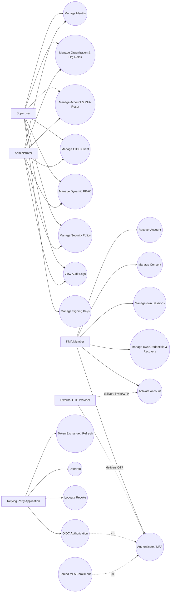

### 2.2. Danh mục Use Case (đồng bộ Actor & RBAC Role)

| ID | Use Case | Actor | RBAC Role tham chiếu (nếu là quản trị) |
| :--- | :--- | :--- | :--- |
| UC-01 | Quản lý Person / Identity | Superuser, Administrator | `IDENTITY_ADMIN` |
| UC-02 | Quản lý Organization / Membership | Superuser, Administrator | `IDENTITY_ADMIN` |
| UC-03 | Quản lý Account (tạo, khóa, mở khóa, force-logout) | Superuser, Administrator | `ACCOUNT_ADMIN` |
| UC-04 | Quản lý Credential cá nhân (xem, đổi tên, thu hồi) | KMA Member | Self-service |
| UC-05 | Đăng ký Passkey / WebAuthn | KMA Member | Self-service |
| UC-06 | Xác thực Passwordless / Multi-step MFA / Step-up | KMA Member, External OTP Provider | Public / Auth flow |
| UC-07 | Đăng nhập SSO vào ứng dụng RP | KMA Member, Relying Party Application | OIDC Protocol |
| UC-08 | Quản lý Application Client (OIDC) | Superuser, Administrator | `APP_INTEGRATION_ADMIN` |
| UC-09 | Quản lý Dynamic RBAC (Role / Permission / Assignment) | Superuser, Administrator | `SUPER_ADMIN` |
| UC-10 | Quản lý Security Policy | Superuser, Administrator | `SECURITY_ADMIN` |
| UC-11 | Tra cứu Audit Log & Authentication Events | Superuser, Administrator | `AUDITOR` |
| UC-12 | Đăng xuất (RP-Initiated Logout) & Thu hồi phiên | KMA Member, Relying Party Application | Self-service / OIDC |
| UC-13 | Quản lý Consent | KMA Member | Self-service |
| UC-14 | Token Exchange (Authorization Code + PKCE) | Relying Party Application | OIDC Protocol |
| UC-15 | Kích hoạt tài khoản lần đầu (Onboarding) | KMA Member, Administrator, External OTP Provider | `ACCOUNT_ADMIN` / Public |
| UC-16 | Khôi phục tài khoản & Reset MFA | KMA Member, Administrator | `ACCOUNT_ADMIN` / Public |
| UC-17 | Thiết lập & Tắt TOTP | KMA Member | Self-service |
| UC-18 | Refresh Token Rotation & Token Revocation | Relying Party Application | OIDC Protocol |
| UC-19 | Quản lý Organization Role & Assignment | Superuser, Administrator | `IDENTITY_ADMIN` |
| UC-20 | Quản lý & Xoay Signing Keys (JWK) | Superuser, Administrator | `SECURITY_ADMIN` |

### 2.3. UC-07 — Đăng nhập SSO vào ứng dụng RP

| Thuộc tính | Nội dung |
| :--- | :--- |
| Mục tiêu | Người dùng đăng nhập RP thông qua KMA IdP bằng Authorization Code + PKCE |
| Actor chính | KMA Member |
| Actor liên quan | Relying Party Application |
| Trigger | Người dùng truy cập tài nguyên được bảo vệ trên RP |
| Tiền điều kiện | RP đã đăng ký; `redirect_uri` khớp chính xác; IdP và Signing Key `ACTIVE` sẵn sàng |
| Hậu điều kiện | RP xác minh ID Token qua JWKS và tạo local session; hoặc từ chối đăng nhập |

**Luồng chính:**
1. User truy cập LMS/Library/Student Portal.
2. RP kiểm tra local session; nếu chưa có, tạo `state`, `nonce`, PKCE `code_verifier`/`code_challenge` (`S256`).
3. RP redirect trình duyệt đến `GET /oauth2/authorize`.
4. IdP validate `client_id` và exact `redirect_uri` trước. Tiếp theo validate `response_type`, `scope`, `state`, `nonce` và tham số PKCE.
5. IdP kiểm tra `IdpSession` từ cookie bảo mật.
6. Nếu chưa có phiên, hoặc phiên không đáp ứng `acr_values`/`max_age`/`prompt=login`, IdP điều hướng tới Login UI / Step-up UI.
7. User xác thực bằng Passkey/OTP/TOTP theo Security Policy (UC-06).
8. IdP kiểm tra trạng thái `Account`, `Credential`, chính sách MFA và `UserConsent`.
9. Nếu cần consent và chưa có consent hợp lệ cho tập scope yêu cầu, IdP hiển thị màn hình Consent để user xác nhận.
10. IdP tạo `AuthorizationCode` ngắn hạn (lưu hash), gắn `account_id`, `session_id`, `application_id`, `redirect_uri`, `code_challenge`, `nonce`, `scopes`, `amr`/`acr`.
11. Browser redirect về RP kèm `code` và `state`.
12. RP kiểm tra `state`, gọi `POST /oauth2/token` kèm `code`, `redirect_uri`, `code_verifier` (và client authentication nếu là Confidential Client).
13. IdP xác thực client, tải và **consume nguyên tử** `AuthorizationCode`, kiểm tra expiry, `redirect_uri`, PKCE.
14. IdP ghi nhận `SESSION_CLIENT`, ký ID Token bằng Signing Key `ACTIVE` (kèm `kid`, `sub`, `nonce`, `sid`, `amr`, `acr`), phát hành Access Token và Refresh Token (nếu được phép).
15. RP lấy public key theo `kid` từ `GET /oauth2/jwks` (có cache), xác minh chữ ký, `iss`, `aud`, `exp`, `nonce` và tạo local session.

**Luồng ngoại lệ:**
- `client_id` hoặc `redirect_uri` không hợp lệ → IdP hiển thị trang lỗi trực tiếp tại IdP, **không redirect**.
- User từ chối consent hoặc `prompt=none` nhưng chưa đăng nhập → IdP redirect về `redirect_uri` kèm `?error=access_denied` (hoặc `login_required`) và `state`.
- Account locked/disabled, code hết hạn/đã dùng, PKCE sai, hoặc ID Token verify lỗi → từ chối cấp token/không tạo local session.

### 2.4. UC-05 — Đăng ký WebAuthn

1. User đã đăng nhập (và đạt mức xác thực Step-up nếu policy yêu cầu) mở trang quản lý Credential.
2. Client gọi `POST /api/v1/me/webauthn/registration/options`.
3. Server tạo challenge ngẫu nhiên, lưu Redis TTL gắn `account_id` và `ceremony=REGISTRATION`, trả `PublicKeyCredentialCreationOptions` kèm `user.id` (`user_handle` opaque).
4. Browser gọi `navigator.credentials.create()`.
5. Authenticator thực hiện user verification và trả attestation response.
6. Client gửi attestation tới `POST /api/v1/me/webauthn/registration/verify`.
7. Server **atomic consume (`GETDEL`) challenge từ Redis**; kiểm tra challenge tồn tại, chưa hết hạn và khớp account/ceremony.
8. Server xác minh `origin`, `rpId`, `attestation`, kiểm tra `credential_id_value` chưa tồn tại.
9. Server lưu `CREDENTIAL` và `WEBAUTHN_CREDENTIAL` vào MySQL, ghi `AUDIT_LOG` và trả `201 Created`.

**Ngoại lệ:** Challenge hết hạn/đã consume (`410`), origin/RP ID sai (`400`), `credential_id_value` trùng (`409`), user hủy thao tác.

### 2.5. UC-06 — Xác thực Passwordless / Multi-step MFA

1. User nhập username (hoặc chọn Passkey discoverable) trên Login UI.
2. IdP kiểm tra rate-limit và trạng thái `Account` (`ACTIVE`, không bị khóa).
3. IdP tạo `AuthenticationTransaction` (Redis TTL) lưu context OIDC (nếu có) và danh sách factor cần hoàn tất theo `SecurityPolicy`.
4. User thực hiện yếu tố 1 (Passkey qua `/api/v1/auth/webauthn/*` hoặc OTP qua `/api/v1/auth/otp/*`).
5. `AuthenticationService` xác minh yếu tố 1 và ghi `AUTHENTICATION_EVENT`.
6. Nếu policy yêu cầu thêm yếu tố 2 (ví dụ TOTP qua `/api/v1/auth/mfa/totp/verify`) hoặc user chưa có MFA bắt buộc (chuyển sang Forced Enrollment), hệ thống yêu cầu hoàn tất bước tiếp theo.
7. Khi đạt mức `acr` yêu cầu, IdP tạo mới (hoặc xoay ID) `IDP_SESSION` với `authentication_level` và `amr`, xóa `AuthenticationTransaction` và tiếp tục luồng SSO hoặc Self-Service.

### 2.6. UC-08 — Quản lý Application Client

1. Administrator có quyền `client.create` mở Client Administration.
2. Nhập tên, `client_type` (`PUBLIC`/`CONFIDENTIAL`), `redirect_uris`, `post_logout_redirect_uris`, `grant_types`, `scopes`, `client_auth_method` và `require_pkce`.
3. Backend validate URI (cấm wildcard, yêu cầu HTTPS trừ localhost dev nếu cho phép) và ràng buộc PKCE (BR-06).
4. Lưu `APPLICATION`, các bảng URI/Scope/Grant và tạo `CLIENT_CREDENTIAL` (lưu hash/secret reference) nếu là Confidential Client.
5. Trả `oneTimeClientSecret` đúng một lần duy nhất; ghi `AUDIT_LOG`.

### 2.7. UC-09 — Quản lý Role và Permission

1. Superuser/Administrator có quyền quản trị RBAC tạo/cập nhật `Role` và chọn `Permission` từ catalog backend.
2. Gán `Role` cho `Account` ở phạm vi system-wide, `organization_id` hoặc `application_id` (tuân thủ BR-14).
3. Backend kiểm tra quyền của actor, phạm vi quản lý và chống privilege escalation (không được cấp quyền cao hơn quyền mình có; không hạ cấp Superuser cuối cùng theo BR-13).
4. Lưu `ACCOUNT_ROLE_ASSIGNMENT` và ghi `AUDIT_LOG`.

### 2.8. UC-12 — Đăng xuất (RP-Initiated Logout) & Thu hồi phiên

1. User nhấn Đăng xuất tại RP hoặc trên trang quản lý phiên (`/me/sessions`).
2. Nếu từ RP: RP xóa local session và redirect trình duyệt tới `GET/POST /connect/logout` kèm `id_token_hint`, `post_logout_redirect_uri` và `state`.
3. IdP validate `id_token_hint` (kiểm tra chữ ký/issuer) và exact match `post_logout_redirect_uri` với `CLIENT_LOGOUT_URI` của client.
4. IdP thu hồi `IDP_SESSION` hiện tại, đánh dấu `SESSION_CLIENT.logged_out_at`, thu hồi các `REFRESH_TOKEN` gắn với `session_id` đó và xóa session cookie.
5. Nếu cấu hình Back-Channel Logout, IdP bất đồng bộ gửi `logout_token` (chứa `sid`, `sub`) tới các RP còn lại trong `SESSION_CLIENT`.
6. Ghi `AUDIT_LOG` và redirect về `post_logout_redirect_uri` (kèm `state`) hoặc trang xác nhận đã đăng xuất tại IdP.

### 2.9. UC-13 — Quản lý Consent

1. User xem danh sách ứng dụng đã cấp quyền qua `GET /api/v1/me/consents`.
2. Khi user thu hồi consent của một ứng dụng (`DELETE /api/v1/me/consents/{consentId}`), IdP cập nhật `USER_CONSENT.status = REVOKED`, `revoked_at = now`.
3. IdP thu hồi toàn bộ `REFRESH_TOKEN` đang hoạt động của `(account_id, application_id)` tương ứng để RP không thể làm mới token sau khi user rút quyền.
4. Ghi `AUDIT_LOG`.

### 2.10. UC-14 & UC-18 — Token Exchange, Refresh Token Rotation & Revocation

1. **Refresh**: RP gửi `POST /oauth2/token` với `grant_type=refresh_token` và `refresh_token`.
2. IdP xác thực client, tìm `REFRESH_TOKEN` theo `token_hash`, kiểm tra client khớp, chưa hết hạn, chưa bị revoke.
3. Nếu hợp lệ và chưa dùng: IdP **consume nguyên tử** token cũ, sinh token mới cùng `family_id` và giữ nguyên (hoặc thu hẹp) tập `REFRESH_TOKEN_SCOPE`, cập nhật `replaced_by_token_id` và trả cặp token mới.
4. Nếu token cũ đã từng bị consume (reuse detected): IdP thu hồi toàn bộ `family_id`, ghi cảnh báo bảo mật mức cao vào `AUDIT_LOG` / SIEM, thu hồi `IdpSession` liên quan theo policy và trả lỗi RFC 6749 `invalid_grant`.
5. **Revocation**: RP gọi `POST /oauth2/revoke` kèm token; IdP thu hồi token (và toàn bộ family nếu là refresh token) và trả `200 OK` theo RFC 7009.

### 2.11. UC-15 — Kích hoạt tài khoản lần đầu (Onboarding)

1. Administrator tạo `Person`, `Identity`, `Account` (trạng thái `PENDING_ACTIVATION`) và gọi `POST /api/v1/accounts/{accountId}/activation-invite` (hoặc đồng bộ tự động từ SIS/HR).
2. IdP tạo `ACCOUNT_ACTIVATION_TOKEN` (TTL ngắn, lưu hash) và gửi liên kết/mã kích hoạt qua kênh đã xác minh (External OTP Provider).
3. User mở liên kết kích hoạt và gửi yêu cầu tới `POST /api/v1/auth/activate`.
4. IdP consume nguyên tử activation token, mở phiên thiết lập tạm (onboarding transaction), yêu cầu user đăng ký tối thiểu 1 credential chính (Passkey hoặc TOTP) và sinh bộ Recovery Codes hiển thị một lần.
5. Sau khi hoàn tất, IdP chuyển `Account.status` sang `ACTIVE`, ghi `AUDIT_LOG` và cấp `IdpSession`.

### 2.12. UC-16 — Khôi phục tài khoản & Reset MFA

**Nhánh A — Tự khôi phục bằng Recovery Code:**
1. User chọn "Mất thiết bị xác thực" tại màn hình đăng nhập và nhập username + 1 Recovery Code (`POST /api/v1/auth/recovery/verify`).
2. IdP kiểm tra rate-limit, đối chiếu `code_hash` chưa dùng và **consume nguyên tử** mã đó.
3. IdP ghi `AUTHENTICATION_EVENT` (method=`RECOVERY_CODE`), tạo phiên giới hạn buộc user đăng ký Passkey/TOTP mới và thu hồi credential đã mất.

**Nhánh B — Administrator hỗ trợ Reset MFA:**
1. User xác minh danh tính trực tiếp với đơn vị quản lý đào tạo/CNTT KMA theo quy trình ngoại tuyến.
2. Administrator có quyền `account.mfa.reset` gọi `POST /api/v1/accounts/{accountId}/mfa/reset` kèm lý do.
3. IdP thu hồi toàn bộ `CREDENTIAL` hiện có, thu hồi toàn bộ `IDP_SESSION` và `REFRESH_TOKEN` (BR-17), chuyển tài khoản sang trạng thái yêu cầu thiết lập lại MFA, phát hành `ACCOUNT_ACTIVATION_TOKEN` mới và ghi `AUDIT_LOG` mức cao.

---

## 3. Activity Diagram / BPMN

### 3.1. Activity — SSO Authorization Code + PKCE (kèm xử lý lỗi OAuth2 & Step-up MFA)

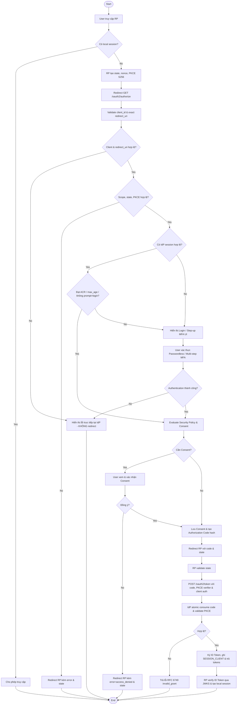

### 3.2. Activity — WebAuthn Registration (Atomic Consume)

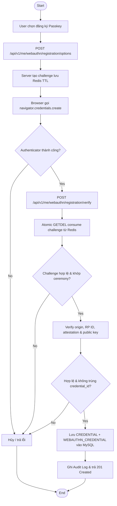

### 3.3. Activity — Gán Role (Dynamic RBAC)

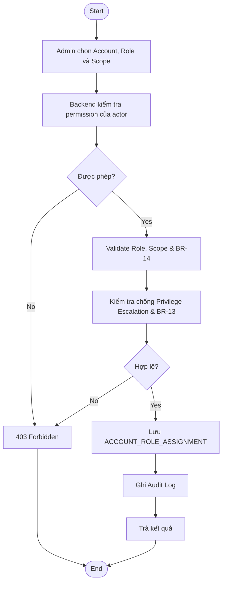

### 3.4. Activity — Single Logout (RP-Initiated Logout)

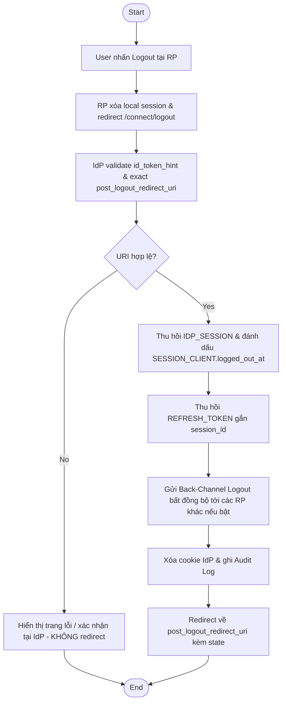

### 3.5. Activity — Account Recovery & MFA Reset

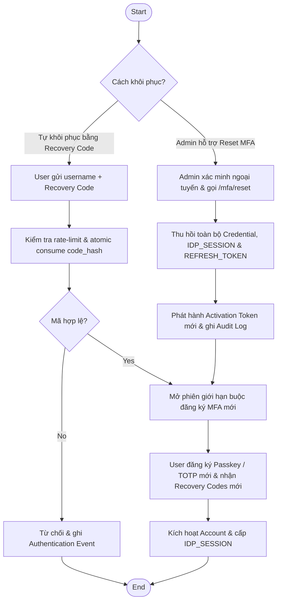

### 3.6. BPMN khái niệm — SSO

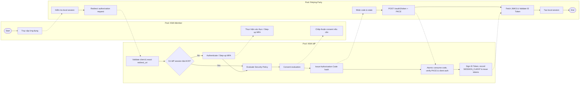

---

## 4. Sequence Diagram

### 4.1. SSO — Authorization Code + PKCE (đầy đủ JWKS, Client Auth & Event Logging)

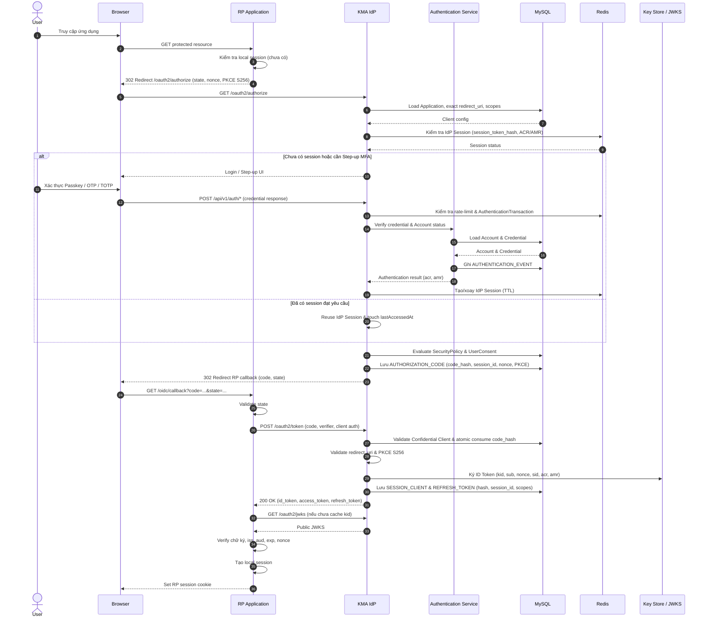

### 4.2. WebAuthn Registration (Atomic Consume Challenge trước khi ghi DB)

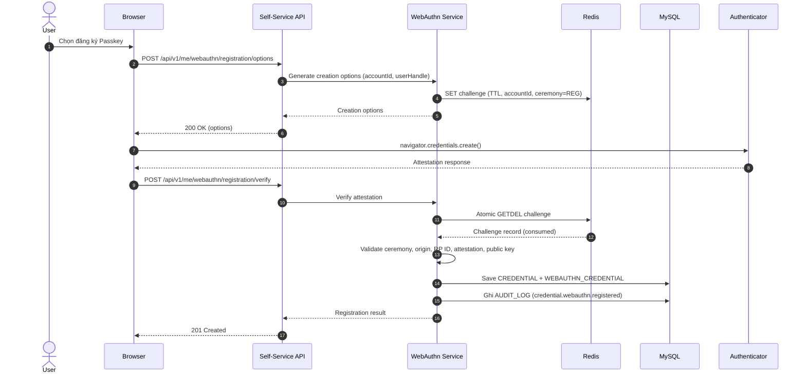

### 4.3. Refresh Token Rotation & Reuse Detection

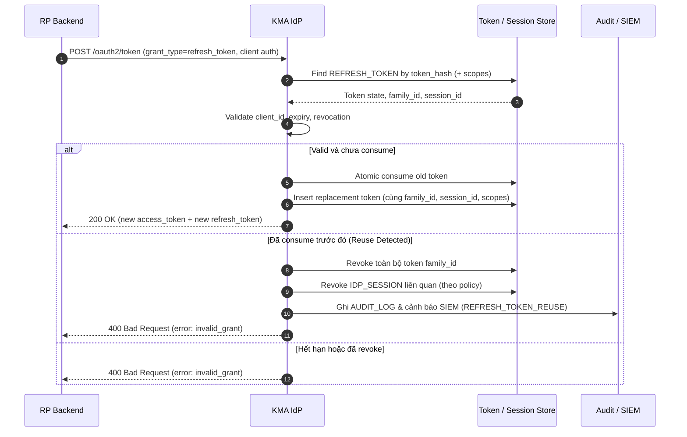

### 4.4. WebAuthn Authentication (Assertion)

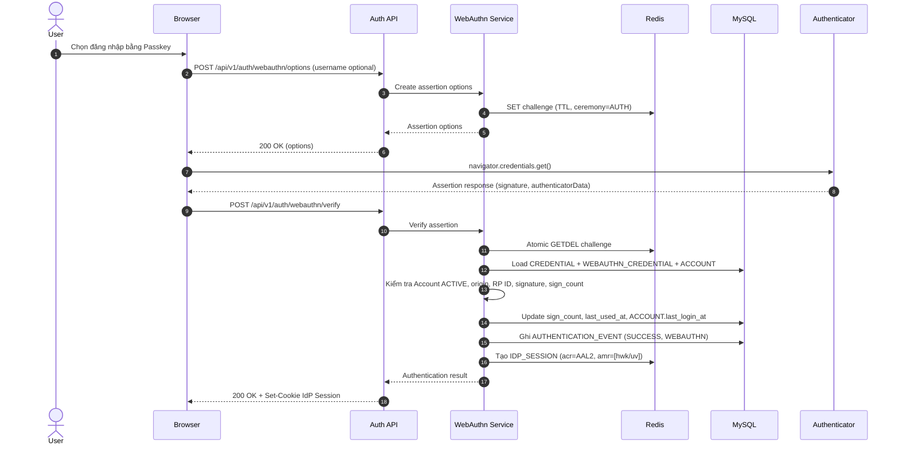

### 4.5. RP-Initiated Logout & Session Revocation

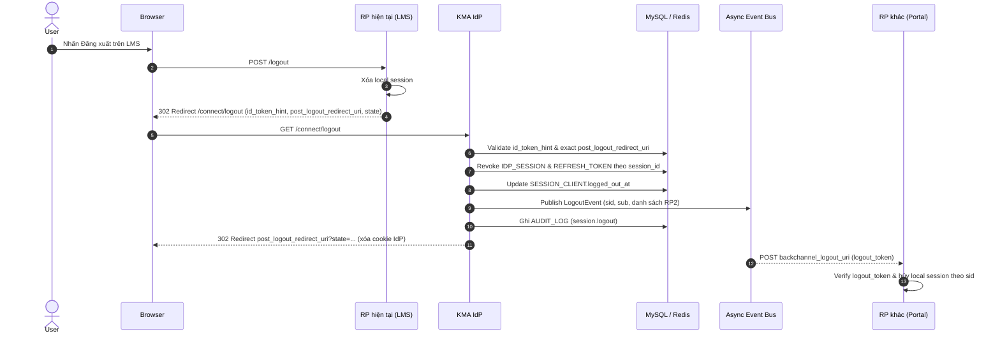

---

## 5. System Architecture

### 5.1. Kiến trúc tổng thể

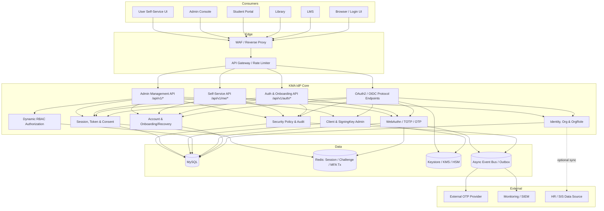

### 5.2. Layered Architecture & Security Boundaries

| Layer | Trách nhiệm |
| :--- | :--- |
| Presentation | Admin Console, User Self-Service UI, Login / Step-up / Consent UI |
| API / Protocol | OAuth2/OIDC Protocol Controllers, Auth API (`/api/v1/auth/*`), Self-Service API (`/api/v1/me/*`), Admin Management API (`/api/v1/*`), Security & Rate-Limit Filters |
| Application | Điều phối use case, transaction boundary, policy evaluation, phát sinh sự kiện bất đồng bộ |
| Domain | Entity, Value Object, domain invariants, business rules |
| Infrastructure | MySQL repositories, Redis stores, Keystore/KMS/HSM signer, Async Event Bus / Outbox (OTP adapter, SIEM forwarder) |

**Phân tách ranh giới bảo mật giữa 3 nhóm API:**
- **`/api/v1/auth/*` (Pre-authentication)**: Phục vụ login WebAuthn/OTP/TOTP, kích hoạt tài khoản và khôi phục bằng Recovery Code; bảo vệ nghiêm ngặt bằng rate-limit, CSRF token và Redis TTL transaction.
- **`/api/v1/me/*` (User Self-Service)**: Chỉ lấy `account_id` từ security context đang đăng nhập (chống IDOR); các thao tác nhạy cảm (đăng ký/xóa Passkey, bật/tắt TOTP, tái tạo Recovery Codes) yêu cầu recent authentication (Step-up `AAL2`).
- **`/api/v1/*` (Admin Management)**: Yêu cầu Access Token có audience/scope quản trị và RBAC permission cụ thể được kiểm tra tại backend.

### 5.3. Bounded Context

| Module | Trách nhiệm | Entity chính |
| :--- | :--- | :--- |
| Identity & Organization | Hồ sơ, định danh, cây đơn vị | `PERSON`, `IDENTITY`, `ORGANIZATION`, `ORG_MEMBERSHIP`, `EXTERNAL_IDENTITY` |
| Organization Roles | Vai trò nghiệp vụ KMA & claim mapping | `ORG_ROLE`, `ORG_ROLE_ASSIGNMENT` |
| Account & Recovery | Vòng đời tài khoản, kích hoạt, khôi phục | `ACCOUNT`, `ACCOUNT_ACTIVATION_TOKEN`, `RECOVERY_CODE` |
| Credential & MFA | Passkey, TOTP, OTP, MFA transaction | `CREDENTIAL`, `WEBAUTHN_CREDENTIAL`, `TOTP_CREDENTIAL`, `AuthenticationTransaction` (Redis) |
| Dynamic RBAC | Phân quyền quản trị IdP | `ROLE`, `PERMISSION`, `ROLE_PERMISSION`, `ACCOUNT_ROLE_ASSIGNMENT` |
| Client & Signing Key | OIDC clients & khóa ký JWT | `APPLICATION`, `CLIENT_*`, `OIDC_SCOPE`, `SIGNING_KEY` |
| Authentication & Federation | SSO, code, token, consent, logout | `IDP_SESSION`, `SESSION_CLIENT`, `AUTHENTICATION_EVENT`, `AUTHORIZATION_CODE`, `REFRESH_TOKEN`, `USER_CONSENT` |
| Security & Audit | Policy và audit trail | `SECURITY_POLICY`, `AUDIT_LOG` |

### 5.4. Công nghệ tham chiếu

- **Backend**: Java 17+, Spring Boot 3.x.
- **OAuth2/OIDC**: Spring Authorization Server hoặc thư viện đạt chuẩn OIDC Conformance.
- **WebAuthn**: WebAuthn4J hoặc Yubico `java-webauthn-server`.
- **Database & Cache**: MySQL 8.x (InnoDB, utf8mb4); Redis 7.x (Sentinel/Cluster tùy HA).
- **Async Messaging**: Outbox table + Message Queue/Broker (hoặc Spring Async có retry/DLQ) cho OTP dispatch, Back-Channel Logout và SIEM forwarding.
- **Frontend**: React/TypeScript (Admin Console, Self-Service, Login UI).
- **API Contract**: OpenAPI 3.0.3, Swagger UI.
- **Cryptographic Keys**: Keystore / Vault / KMS / HSM theo hạ tầng KMA.

### 5.5. Security Architecture

- TLS 1.2+/1.3 bắt buộc; cookie `Secure`, `HttpOnly`, `SameSite=Lax` (hoặc `None` có kiểm soát cho cross-site flow nếu cần), xoay session ID sau mỗi lần nâng mức xác thực (chống Session Fixation).
- Authorization Code + PKCE (`S256`); validate `state`, `nonce`, `iss`, `aud`, exact `redirect_uri`.
- JWT ký bất đối xứng với `kid` và vòng đời `SIGNING_KEY` (`NEXT → ACTIVE → RETIRED`).
- Hash một chiều cho Authorization Code, Refresh Token, Activation Token, Recovery Code và Client Secret; TOTP secret mã hóa AES-GCM kèm `encryption_key_id`.
- Atomic consume trên Redis/DB cho challenge, authorization code, refresh token và recovery code.
- CORS allowlist chặt; CSP/HSTS/X-Frame-Options; audit append-only không chứa dữ liệu nhạy cảm.

### 5.6. Triển khai

Reverse Proxy/WAF → API Gateway → Stateless KMA IdP instances → MySQL + Redis + Key Store + Async Bus. Duy trì 4 môi trường Dev/Test/UAT/Production, diễn tập backup/restore, centralized logging, alerting và runbook vận hành. Sizing HA/DR và pool size chốt sau load test.

---

## 6. Class Diagram

### 6.1. Identity, Account, Credential và Recovery

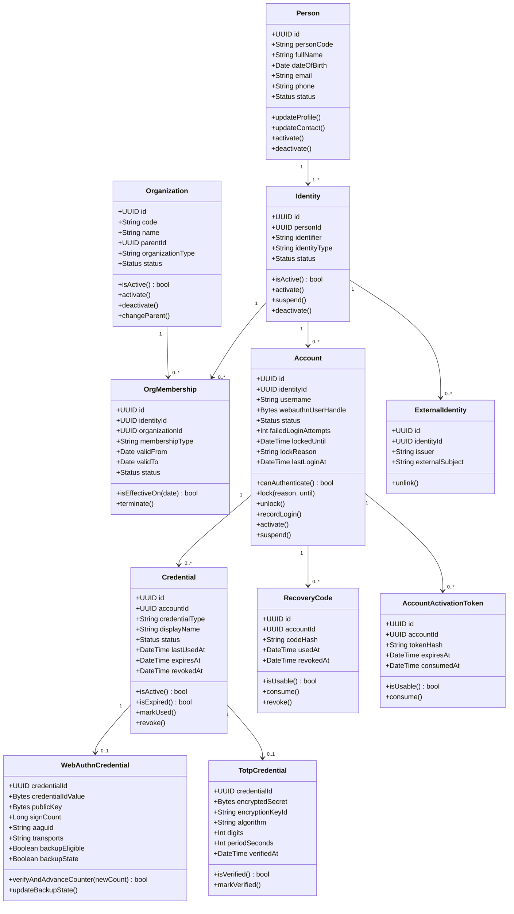

### 6.2. Dynamic RBAC và Organization Role

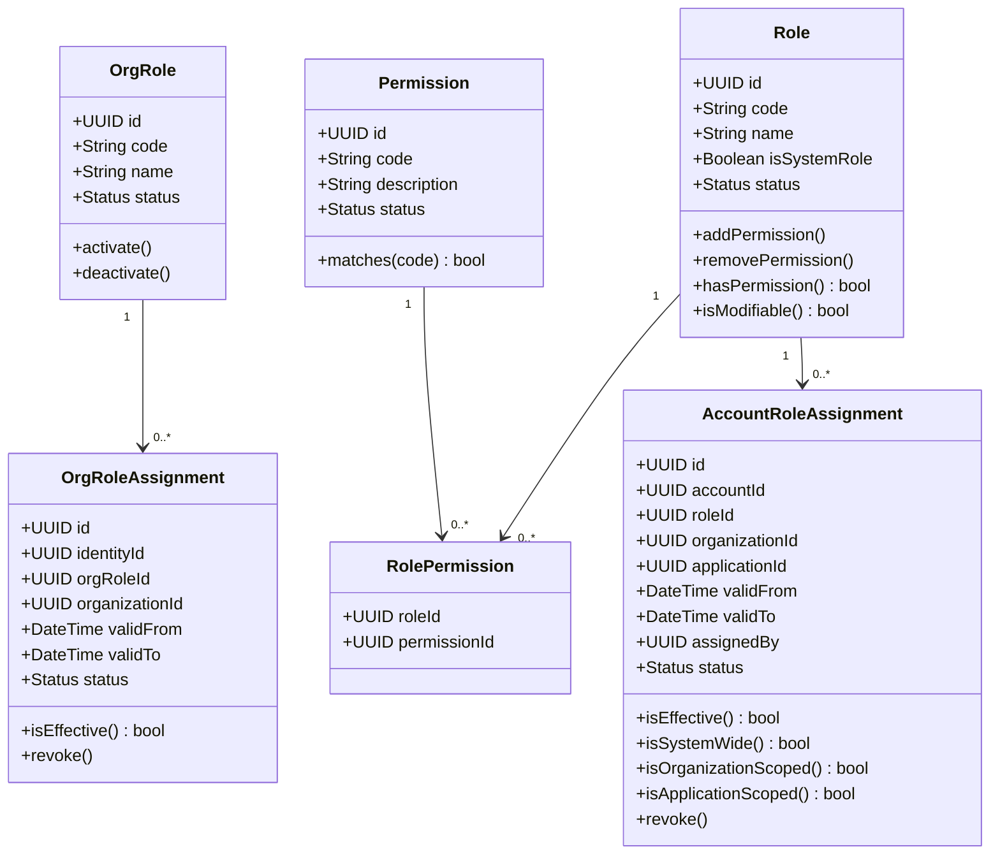

### 6.3. Application Client và Signing Key

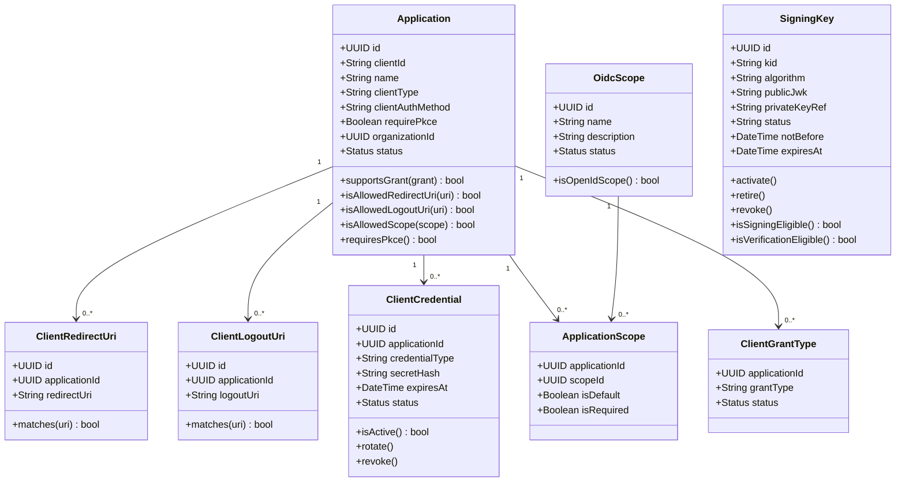

### 6.4. Authentication, Session, Token, Policy và Audit

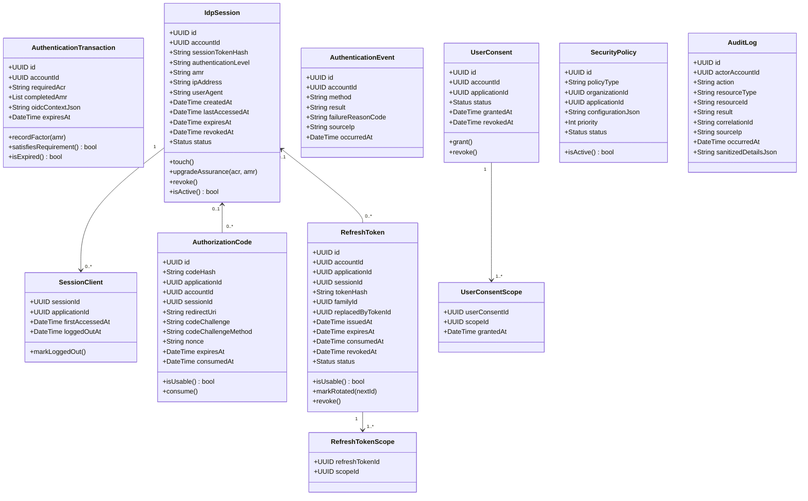

### 6.5. Service Layer (đã tách trách nhiệm)

| Service | Trách nhiệm |
| :--- | :--- |
| `IdentityService` | Tạo/cập nhật Person, Identity, ExternalIdentity |
| `OrganizationService` | Quản lý cây Organization, OrgMembership, OrgRole & OrgRoleAssignment |
| `AccountService` | Vòng đời Account, khóa/mở khóa, quản lý trạng thái |
| `OnboardingRecoveryService` | Phát hành/consume Activation Token, tạo/verify Recovery Codes, Admin MFA Reset |
| `CredentialService` | Vòng đời Credential chung, TOTP setup/verify/disable, thu hồi credential |
| `WebAuthnService` | Registration/assertion options, atomic challenge consume, attestation/signature verify |
| `AuthenticationService` | Điều phối Multi-step MFA (`AuthenticationTransaction`), Step-up, rate-limit, `AuthenticationEvent` |
| `RbacAuthorizationService` | Đánh giá Dynamic RBAC (Role, Permission, scope, chống privilege escalation) |
| `OidcAuthorizationService` | Xử lý `/oauth2/authorize`, policy/consent check, phát hành & consume `AuthorizationCode` |
| `ApplicationClientService` | Quản trị OIDC Client, URI, scope, grant type, client secret rotation |
| `SigningKeyService` | Tạo, xoay vòng (`NEXT → ACTIVE → RETIRED`) và xuất công khai JWKS |
| `TokenService` | Ký ID/Access Token, Refresh Token rotation & reuse detection, Revocation/Introspection |
| `SessionService` | Vòng đời `IdpSession`, `SessionClient`, RP-Initiated & Back-Channel Logout |
| `ConsentService` | Cấp và thu hồi `UserConsent` (kèm thu hồi Refresh Token liên quan) |
| `SecurityPolicyService` | Đánh giá và phân giải độ ưu tiên Security Policy (Global / Org / App) |
| `AuditService` | Ghi `AuditLog` append-only và đẩy sự kiện bất đồng bộ sang SIEM |

---

## 7. ERD — Entity Relationship Diagram

### 7.1. ERD tổng quan (đã đồng bộ đầy đủ quan hệ & bảng core)

```mermaid
erDiagram
 ORGANIZATION ||--o{ ORGANIZATION : parent_child
 PERSON ||--|{ IDENTITY : owns
 IDENTITY ||--o{ ACCOUNT : has
 IDENTITY ||--o{ ORG_MEMBERSHIP : member
 ORGANIZATION ||--o{ ORG_MEMBERSHIP : contains
 IDENTITY ||--o{ EXTERNAL_IDENTITY : federates
 IDENTITY ||--o{ ORG_ROLE_ASSIGNMENT : receives
 ORG_ROLE ||--o{ ORG_ROLE_ASSIGNMENT : assigned
 ORGANIZATION ||--o{ ORG_ROLE_ASSIGNMENT : scoped_in

 ACCOUNT ||--o{ CREDENTIAL : owns
 CREDENTIAL ||--o| WEBAUTHN_CREDENTIAL : webauthn_detail
 CREDENTIAL ||--o| TOTP_CREDENTIAL : totp_detail
 ACCOUNT ||--o{ RECOVERY_CODE : owns
 ACCOUNT ||--o{ ACCOUNT_ACTIVATION_TOKEN : activates

 ROLE ||--o{ ROLE_PERMISSION : includes
 PERMISSION ||--o{ ROLE_PERMISSION : included
 ACCOUNT ||--o{ ACCOUNT_ROLE_ASSIGNMENT : receives
 ROLE ||--o{ ACCOUNT_ROLE_ASSIGNMENT : assigned
 ORGANIZATION o|--o{ ACCOUNT_ROLE_ASSIGNMENT : scoped_org
 APPLICATION o|--o{ ACCOUNT_ROLE_ASSIGNMENT : scoped_app

 ORGANIZATION o|--o{ APPLICATION : owns
 APPLICATION ||--o{ CLIENT_REDIRECT_URI : allows
 APPLICATION ||--o{ CLIENT_LOGOUT_URI : allows
 APPLICATION ||--o{ CLIENT_CREDENTIAL : owns
 APPLICATION ||--o{ APPLICATION_SCOPE : enables
 OIDC_SCOPE ||--o{ APPLICATION_SCOPE : enabled
 APPLICATION ||--o{ CLIENT_GRANT_TYPE : supports

 ACCOUNT ||--o{ IDP_SESSION : opens
 IDP_SESSION ||--o{ SESSION_CLIENT : used_by
 APPLICATION ||--o{ SESSION_CLIENT : accessed_by
 ACCOUNT ||--o{ AUTHENTICATION_EVENT : generates

 ACCOUNT ||--o{ AUTHORIZATION_CODE : initiates
 APPLICATION ||--o{ AUTHORIZATION_CODE : receives
 IDP_SESSION o|--o{ AUTHORIZATION_CODE : bound_to
 AUTHORIZATION_CODE ||--o{ AUTHORIZATION_CODE_SCOPE : contains
 OIDC_SCOPE ||--o{ AUTHORIZATION_CODE_SCOPE : requested

 ACCOUNT ||--o{ REFRESH_TOKEN : owns
 APPLICATION ||--o{ REFRESH_TOKEN : issued_to
 IDP_SESSION o|--o{ REFRESH_TOKEN : bound_to
 REFRESH_TOKEN ||--o{ REFRESH_TOKEN_SCOPE : grants
 OIDC_SCOPE ||--o{ REFRESH_TOKEN_SCOPE : granted

 ACCOUNT ||--o{ USER_CONSENT : grants
 APPLICATION ||--o{ USER_CONSENT : receives
 USER_CONSENT ||--o{ USER_CONSENT_SCOPE : contains
 OIDC_SCOPE ||--o{ USER_CONSENT_SCOPE : consented

 ORGANIZATION o|--o{ SECURITY_POLICY : scoped_org
 APPLICATION o|--o{ SECURITY_POLICY : scoped_app
 ACCOUNT o|--o{ AUDIT_LOG : actor
 SIGNING_KEY
```

### 7.2. Data Dictionary — Bảng và thuộc tính chính

#### Identity, Organization & Org Roles

| Bảng | Cột chính |
| :--- | :--- |
| `ORGANIZATION` | `id` PK, `parent_id` FK self, `code` UK, `name`, `organization_type`, `status`, timestamps |
| `PERSON` | `id` PK, `person_code` UK nullable, `full_name`, `date_of_birth`, `email`, `phone`, `status`, timestamps |
| `IDENTITY` | `id` PK, `person_id` FK, `identifier`, `identity_type`, `status`, timestamps; UK `(identity_type, identifier)` |
| `ORG_MEMBERSHIP` | `id` PK, `identity_id` FK, `organization_id` FK, `membership_type`, `valid_from`, `valid_to`, `status` |
| `EXTERNAL_IDENTITY` | `id` PK, `identity_id` FK, `issuer`, `external_subject`, `created_at`; UK `(issuer, external_subject)` |
| `ORG_ROLE` | `id` PK, `code` UK, `name`, `description`, `status` |
| `ORG_ROLE_ASSIGNMENT` | `id` PK, `identity_id` FK, `org_role_id` FK, `organization_id` FK, `valid_from`, `valid_to`, `status` |

#### Account, Credential & Recovery

| Bảng | Cột chính |
| :--- | :--- |
| `ACCOUNT` | `id` PK, `identity_id` FK, `username` UK, `webauthn_user_handle` UK (bytes opaque), `status`, `failed_login_attempts`, `locked_until`, `lock_reason`, `last_login_at`, timestamps |
| `CREDENTIAL` | `id` PK, `account_id` FK, `credential_type` (`WEBAUTHN`, `TOTP`), `display_name`, `status`, `created_at`, `last_used_at`, `expires_at`, `revoked_at` |
| `WEBAUTHN_CREDENTIAL` | `credential_id` PK/FK → `CREDENTIAL`, `credential_id_value` UK, `public_key`, `sign_count`, `aaguid`, `transports`, `backup_eligible`, `backup_state` |
| `TOTP_CREDENTIAL` | `credential_id` PK/FK → `CREDENTIAL`, `encrypted_secret`, `encryption_key_id`, `algorithm`, `digits`, `period_seconds`, `verified_at` |
| `RECOVERY_CODE` | `id` PK, `account_id` FK, `code_hash` UK, `created_at`, `used_at`, `revoked_at` |
| `ACCOUNT_ACTIVATION_TOKEN` | `id` PK, `account_id` FK, `token_hash` UK, `purpose` (`ACTIVATION`, `MFA_RESET`), `expires_at`, `consumed_at`, `created_at` |

#### Dynamic RBAC

| Bảng | Cột chính |
| :--- | :--- |
| `ROLE` | `id` PK, `code` UK, `name`, `description`, `is_system_role`, `status` |
| `PERMISSION` | `id` PK, `code` UK, `description`, `status` |
| `ROLE_PERMISSION` | PK `(role_id, permission_id)`, cả hai là FK |
| `ACCOUNT_ROLE_ASSIGNMENT` | `id` PK, `account_id` FK, `role_id` FK, `organization_id` FK nullable, `application_id` FK nullable, `valid_from`, `valid_to`, `assigned_by`, `status`; `CHECK (NOT (organization_id IS NOT NULL AND application_id IS NOT NULL))` |

#### Application Client & Signing Keys

| Bảng | Cột chính |
| :--- | :--- |
| `APPLICATION` | `id` PK, `client_id` UK, `name`, `client_type`, `client_auth_method`, `require_pkce`, `organization_id` FK nullable, `status`, timestamps |
| `CLIENT_REDIRECT_URI` | `id` PK, `application_id` FK, `redirect_uri`; UK `(application_id, redirect_uri)` |
| `CLIENT_LOGOUT_URI` | `id` PK, `application_id` FK, `logout_uri`; UK `(application_id, logout_uri)` |
| `CLIENT_CREDENTIAL` | `id` PK, `application_id` FK, `credential_type`, `secret_hash`, `expires_at`, `revoked_at`, `status`, timestamps |
| `OIDC_SCOPE` | `id` PK, `name` UK, `description`, `status` |
| `APPLICATION_SCOPE` | PK `(application_id, scope_id)`, `is_default`, `is_required` |
| `CLIENT_GRANT_TYPE` | PK `(application_id, grant_type)`, `status` |
| `SIGNING_KEY` | `id` PK, `kid` UK, `algorithm`, `public_jwk` JSON, `private_key_ref`, `status` (`NEXT`, `ACTIVE`, `RETIRED`, `REVOKED`), `not_before`, `expires_at`, `created_at` |

#### Authentication, Session, Token & Audit

| Bảng | Cột chính |
| :--- | :--- |
| `IDP_SESSION` | `id` PK, `account_id` FK, `session_token_hash` UK, `authentication_level` (`AAL1`/`AAL2`), `amr` JSON, `ip_address`, `user_agent`, `created_at`, `last_accessed_at`, `expires_at`, `revoked_at`, `status` |
| `SESSION_CLIENT` | PK `(session_id, application_id)`, `first_accessed_at`, `logged_out_at` |
| `AUTHENTICATION_EVENT` | `id` PK, `account_id` FK nullable, `method`, `result`, `failure_reason_code`, `source_ip`, `user_agent`, `occurred_at` |
| `AUTHORIZATION_CODE` | `id` PK, `code_hash` UK, `application_id` FK, `account_id` FK, `session_id` FK nullable, `redirect_uri`, `code_challenge`, `code_challenge_method`, `nonce`, `expires_at`, `consumed_at` |
| `AUTHORIZATION_CODE_SCOPE` | PK `(authorization_code_id, scope_id)` |
| `REFRESH_TOKEN` | `id` PK, `token_hash` UK, `account_id` FK, `application_id` FK, `session_id` FK nullable, `family_id`, `replaced_by_token_id` FK self nullable, `issued_at`, `expires_at`, `consumed_at`, `revoked_at`, `status` |
| `REFRESH_TOKEN_SCOPE` | PK `(refresh_token_id, scope_id)` |
| `USER_CONSENT` | `id` PK, `account_id` FK, `application_id` FK, `status`, `granted_at`, `revoked_at`; UK `(account_id, application_id)` |
| `USER_CONSENT_SCOPE` | PK `(user_consent_id, scope_id)`, `granted_at` |
| `SECURITY_POLICY` | `id` PK, `policy_type`, `organization_id` FK nullable, `application_id` FK nullable, `configuration` JSON, `priority`, `status`, timestamps; `CHECK (NOT (organization_id IS NOT NULL AND application_id IS NOT NULL))` |
| `AUDIT_LOG` | `id` PK, `actor_account_id` FK nullable, `action`, `resource_type`, `resource_id`, `result`, `correlation_id`, `source_ip`, `occurred_at`, `details` JSON sanitized |

### 7.3. Ràng buộc và chỉ mục trọng yếu

- **Unique Constraints**: `ORGANIZATION(code)`, `PERSON(person_code)`, `IDENTITY(identity_type, identifier)`, `ACCOUNT(username)`, `ACCOUNT(webauthn_user_handle)`, `EXTERNAL_IDENTITY(issuer, external_subject)`, `WEBAUTHN_CREDENTIAL(credential_id_value)`, `RECOVERY_CODE(code_hash)`, `ACCOUNT_ACTIVATION_TOKEN(token_hash)`, `ROLE(code)`, `PERMISSION(code)`, `ORG_ROLE(code)`, `APPLICATION(client_id)`, `SIGNING_KEY(kid)`, `IDP_SESSION(session_token_hash)`, `AUTHORIZATION_CODE(code_hash)`, `REFRESH_TOKEN(token_hash)`, `USER_CONSENT(account_id, application_id)`.
- **Check Constraints (BR-14)**: `ACCOUNT_ROLE_ASSIGNMENT` và `SECURITY_POLICY` bắt buộc `NOT (organization_id IS NOT NULL AND application_id IS NOT NULL)`.
- **Indexes hiệu năng**: `ORGANIZATION(parent_id)`, `ACCOUNT(identity_id, status)`, `REFRESH_TOKEN(family_id)`, `REFRESH_TOKEN(session_id)`, `REFRESH_TOKEN(expires_at)`, `AUTHORIZATION_CODE(expires_at)`, `AUDIT_LOG(occurred_at)`, `AUDIT_LOG(actor_account_id, occurred_at)`, `AUDIT_LOG(resource_type, resource_id)`.

### 7.4. Chiến lược lưu trữ dữ liệu

| Dữ liệu | Nơi lưu đề xuất |
| :--- | :--- |
| Person, Identity, Organization, OrgRole, Account | MySQL |
| Credential metadata, WebAuthn public key, TOTP encrypted secret, RecoveryCode hash | MySQL |
| WebAuthn challenge, OTP transaction, `AuthenticationTransaction`, Rate-limit counters | Redis (TTL ngắn, atomic `GETDEL`) |
| `IdpSession` | Redis + MySQL (hoặc Redis HA theo quyết định Mục 11) |
| `AuthorizationCode` | Store có atomic consume (Redis hoặc MySQL); hash, TTL ngắn (≤ 60s) |
| `RefreshToken` & `RefreshTokenScope` | MySQL; hash, rotation, family reuse detection |
| Access Token JWT | Stateless JWT (không bắt buộc lưu DB; thu hồi ngắn hạn dựa vào TTL ngắn) |
| `SigningKey` private key & Client secret | Keystore / KMS / HSM (private key); hash (client secret) |
| `AuditLog` | MySQL (append-oriented, partition theo tháng) + đẩy bất đồng bộ sang SIEM |

---

## 8. API Specification — OpenAPI / Swagger

### 8.1. Quy ước thống nhất

- **Prefix phân tách rõ**:
  - OAuth2/OIDC Protocol Endpoints: path chuẩn gốc (`/oauth2/*`, `/userinfo`, `/connect/logout`, `/.well-known/*`).
  - Pre-auth / Onboarding / Recovery API: `/api/v1/auth/*`.
  - User Self-Service API: `/api/v1/me/*` (lấy `account_id` từ security context).
  - Admin Management API: `/api/v1/*` (enforce Dynamic RBAC tại backend).
- **Response Envelope thống nhất**:
  - Single resource: `{ "data": { ... } }` (có thể kèm metadata một lần như `oneTimeClientSecret` hoặc `oneTimeRecoveryCodes`).
  - Paginated list: `{ "data": [ ... ], "page": 0, "size": 20, "totalElements": 100 }`.
- **Chuẩn lỗi tách biệt**:
  - Management / Self-Service / Auth API (`/api/v1/*`): RFC 9457 Problem Details (`application/problem+json`) kèm `code` và `requestId`.
  - OAuth2/OIDC Token Endpoint (`/oauth2/token`): JSON chuẩn RFC 6749 §5.2 (`{ "error": "invalid_grant", "error_description": "..." }`).

### 8.2. API Catalog đầy đủ

#### Identity, Organization & Org Roles

| Method | Endpoint | Chức năng |
| :--- | :--- | :--- |
| POST / GET | `/api/v1/persons` | Tạo / liệt kê Person (phân trang) |
| GET / PATCH | `/api/v1/persons/{personId}` | Xem / cập nhật Person |
| POST / GET | `/api/v1/identities` | Tạo / liệt kê Identity |
| GET / PATCH | `/api/v1/identities/{identityId}` | Xem / cập nhật Identity |
| POST / GET | `/api/v1/organizations` | Tạo / liệt kê Organization |
| GET / PATCH | `/api/v1/organizations/{organizationId}` | Xem / cập nhật Organization |
| POST | `/api/v1/organizations/{organizationId}/memberships` | Thêm thành viên vào Organization |
| POST / GET | `/api/v1/org-roles` | Tạo / liệt kê Organization Role (`STUDENT`, `LECTURER`, ...) |
| POST / GET | `/api/v1/identities/{identityId}/org-roles` | Gán / xem Organization Role của Identity |
| DELETE | `/api/v1/identities/{identityId}/org-roles/{assignmentId}` | Thu hồi Organization Role |

#### Account, Onboarding, Recovery & Incident Response

| Method | Endpoint | Chức năng |
| :--- | :--- | :--- |
| POST / GET | `/api/v1/accounts` | Tạo / liệt kê Account (phân trang) |
| GET / PATCH | `/api/v1/accounts/{accountId}` | Xem / cập nhật Account |
| POST | `/api/v1/accounts/{accountId}/lock` | Khóa Account (kèm thu hồi phiên) |
| POST | `/api/v1/accounts/{accountId}/unlock` | Mở khóa Account |
| POST | `/api/v1/accounts/{accountId}/activation-invite` | Phát hành activation token onboarding |
| POST | `/api/v1/accounts/{accountId}/mfa/reset` | Admin reset MFA (thu hồi credential, phiên, refresh token) |
| GET / DELETE | `/api/v1/accounts/{accountId}/sessions` | Admin xem / force-logout toàn bộ phiên của Account |
| DELETE | `/api/v1/accounts/{accountId}/credentials/{credentialId}` | Admin thu hồi credential khi có sự cố |

#### Pre-Authentication & Recovery (`/api/v1/auth/*`)

| Method | Endpoint | Chức năng |
| :--- | :--- | :--- |
| POST | `/api/v1/auth/activate` | Xác minh activation token & bắt đầu onboarding |
| POST | `/api/v1/auth/webauthn/options` | Lấy WebAuthn assertion options (đăng nhập) |
| POST | `/api/v1/auth/webauthn/verify` | Xác minh WebAuthn assertion (đăng nhập) |
| POST | `/api/v1/auth/otp/request` | Yêu cầu gửi OTP |
| POST | `/api/v1/auth/otp/verify` | Xác minh OTP |
| POST | `/api/v1/auth/mfa/totp/verify` | Xác minh TOTP bước 2 trong Multi-step MFA |
| POST | `/api/v1/auth/recovery/verify` | Xác minh Recovery Code một lần khi mất thiết bị |

#### User Self-Service (`/api/v1/me/*`)

| Method | Endpoint | Chức năng |
| :--- | :--- | :--- |
| GET | `/api/v1/me/credentials` | Xem danh sách Credential của bản thân |
| DELETE | `/api/v1/me/credentials/{credentialId}` | Thu hồi Credential của bản thân |
| POST | `/api/v1/me/webauthn/registration/options` | Lấy WebAuthn registration options |
| POST | `/api/v1/me/webauthn/registration/verify` | Xác minh và lưu Passkey mới |
| POST | `/api/v1/me/totp/setup` | Khởi tạo TOTP secret (hiển thị QR một lần) |
| POST | `/api/v1/me/totp/verify` | Xác minh mã TOTP đầu tiên để kích hoạt |
| DELETE | `/api/v1/me/totp` | Tắt TOTP (yêu cầu Step-up) |
| POST | `/api/v1/me/recovery-codes/regenerate` | Tái tạo bộ Recovery Codes mới (hiển thị một lần) |
| GET / DELETE | `/api/v1/me/sessions` | Xem / thu hồi tất cả phiên khác của bản thân |
| DELETE | `/api/v1/me/sessions/{sessionId}` | Thu hồi một phiên cụ thể |
| GET | `/api/v1/me/consents` | Xem các ứng dụng đã cấp consent |
| DELETE | `/api/v1/me/consents/{consentId}` | Thu hồi consent theo ứng dụng (kèm revoke refresh token) |

#### Dynamic RBAC, Client, Signing Key, Policy & Audit

| Method | Endpoint | Chức năng |
| :--- | :--- | :--- |
| POST / GET | `/api/v1/roles` | Tạo / liệt kê Role |
| GET / PATCH | `/api/v1/roles/{roleId}` | Xem / cập nhật Role |
| PUT | `/api/v1/roles/{roleId}/permissions` | Gán tập Permission cho Role |
| GET | `/api/v1/permissions` | Xem Permission catalog |
| POST / GET | `/api/v1/accounts/{accountId}/role-assignments` | Gán / xem Role assignment của Account |
| DELETE | `/api/v1/role-assignments/{assignmentId}` | Thu hồi Role assignment |
| POST / GET | `/api/v1/applications` | Đăng ký / liệt kê OIDC Client |
| GET / PATCH | `/api/v1/applications/{applicationId}` | Xem / cập nhật OIDC Client |
| POST / DELETE | `/api/v1/applications/{applicationId}/redirect-uris/{uriId}` | Thêm / xóa Redirect URI (`POST` không cần `{uriId}`) |
| POST / DELETE | `/api/v1/applications/{applicationId}/logout-uris/{uriId}` | Thêm / xóa Post-Logout Redirect URI |
| POST | `/api/v1/applications/{applicationId}/credentials/rotate` | Xoay Client Secret (trả một lần) |
| POST | `/api/v1/applications/{applicationId}/credentials/{credentialId}/revoke` | Thu hồi Client Credential |
| PUT | `/api/v1/applications/{applicationId}/scopes` | Cấu hình scopes cho Client |
| PUT | `/api/v1/applications/{applicationId}/grant-types` | Cấu hình grant types cho Client |
| GET | `/api/v1/signing-keys` | Xem metadata Signing Keys (`kid`, `status`) |
| POST | `/api/v1/signing-keys/rotate` | Xoay Signing Key (`NEXT → ACTIVE → RETIRED`) |
| GET / POST | `/api/v1/security-policies` | Liệt kê / tạo Security Policy |
| PATCH | `/api/v1/security-policies/{policyId}` | Cập nhật Security Policy |
| GET | `/api/v1/audit-logs` | Tra cứu Audit Log (phân trang) |
| GET | `/api/v1/authentication-events` | Tra cứu Authentication Events (phân trang) |

### 8.3. OAuth2 / OIDC Protocol Endpoints

| Method | Endpoint | Chức năng |
| :--- | :--- | :--- |
| GET | `/.well-known/openid-configuration` | OIDC Discovery |
| GET | `/oauth2/authorize` | Authorization Endpoint |
| POST | `/oauth2/token` | Token Endpoint (`application/x-www-form-urlencoded`) |
| GET / POST | `/userinfo` | UserInfo Endpoint |
| GET | `/oauth2/jwks` | JSON Web Key Set (Public Keys) |
| POST | `/oauth2/revoke` | Token Revocation (RFC 7009) |
| POST | `/oauth2/introspect` | Token Introspection (RFC 7662, nếu bật) |
| GET / POST | `/connect/logout` | RP-Initiated Logout |

### 8.4. Permission Codes tham chiếu

`identity.create/read/update`; `organization.create/read/update`; `org_role.create/read/assign/revoke`; `account.create/read/update/lock/unlock/activate_invite`; `account.mfa.reset`; `credential.read/revoke`; `session.read/revoke`; `role.create/read/update`; `permission.read`; `role.permission.manage`; `role.assignment.create/read/revoke`; `client.create/read/update`; `client.credential.rotate/revoke`; `client.scope.manage`; `client.grant.manage`; `signing_key.read/rotate`; `security.policy.read/manage`; `audit.log.read`.

### 8.5. OpenAPI 3.0.3 YAML — Contract chuẩn hóa v1.1

```yaml
openapi: 3.0.3
info:
  title: KMA IdP Management, Self-Service & Auth API
  version: 1.1.0
  description: >
    REST API cho KMA Identity Provider (v1.1). OAuth2/OIDC Protocol Endpoints
    (/oauth2/*, /userinfo, /connect/logout) được tách riêng theo chuẩn RFC 6749/OIDC.
servers:
  - url: https://idp.example.edu.vn/api/v1
tags:
  - name: Persons
  - name: Organizations
  - name: OrgRoles
  - name: Accounts
  - name: Auth
  - name: SelfService
  - name: Roles
  - name: Applications
  - name: SigningKeys
  - name: Audit
security:
  - bearerAuth: []
paths:
  /persons:
    get:
      tags: [Persons]
      summary: List persons
      operationId: listPersons
      parameters:
        - $ref: '#/components/parameters/Page'
        - $ref: '#/components/parameters/Size'
      responses:
        '200':
          description: Person page
          content:
            application/json:
              schema: { $ref: '#/components/schemas/PagePerson' }
        '401': { $ref: '#/components/responses/Unauthorized' }
        '403': { $ref: '#/components/responses/Forbidden' }
    post:
      tags: [Persons]
      summary: Create person
      operationId: createPerson
      requestBody:
        required: true
        content:
          application/json:
            schema: { $ref: '#/components/schemas/PersonCreate' }
      responses:
        '201':
          description: Created
          content:
            application/json:
              schema: { $ref: '#/components/schemas/PersonResponse' }
        '400': { $ref: '#/components/responses/BadRequest' }
        '401': { $ref: '#/components/responses/Unauthorized' }
        '403': { $ref: '#/components/responses/Forbidden' }
        '409': { $ref: '#/components/responses/Conflict' }

  /persons/{personId}:
    parameters:
      - name: personId
        in: path
        required: true
        schema: { type: string, format: uuid }
    get:
      tags: [Persons]
      summary: Get person
      operationId: getPerson
      responses:
        '200':
          description: Person
          content:
            application/json:
              schema: { $ref: '#/components/schemas/PersonResponse' }
        '401': { $ref: '#/components/responses/Unauthorized' }
        '403': { $ref: '#/components/responses/Forbidden' }
        '404': { $ref: '#/components/responses/NotFound' }
    patch:
      tags: [Persons]
      summary: Update person
      operationId: updatePerson
      requestBody:
        required: true
        content:
          application/json:
            schema: { $ref: '#/components/schemas/PersonUpdate' }
      responses:
        '200':
          description: Updated
          content:
            application/json:
              schema: { $ref: '#/components/schemas/PersonResponse' }
        '400': { $ref: '#/components/responses/BadRequest' }
        '401': { $ref: '#/components/responses/Unauthorized' }
        '403': { $ref: '#/components/responses/Forbidden' }
        '404': { $ref: '#/components/responses/NotFound' }

  /organizations:
    get:
      tags: [Organizations]
      summary: List organizations
      operationId: listOrganizations
      parameters:
        - $ref: '#/components/parameters/Page'
        - $ref: '#/components/parameters/Size'
      responses:
        '200':
          description: Organization page
          content:
            application/json:
              schema: { $ref: '#/components/schemas/PageOrganization' }
        '401': { $ref: '#/components/responses/Unauthorized' }
        '403': { $ref: '#/components/responses/Forbidden' }
    post:
      tags: [Organizations]
      summary: Create organization
      operationId: createOrganization
      requestBody:
        required: true
        content:
          application/json:
            schema: { $ref: '#/components/schemas/OrganizationCreate' }
      responses:
        '201':
          description: Created
          content:
            application/json:
              schema: { $ref: '#/components/schemas/OrganizationResponse' }
        '400': { $ref: '#/components/responses/BadRequest' }
        '401': { $ref: '#/components/responses/Unauthorized' }
        '403': { $ref: '#/components/responses/Forbidden' }
        '409': { $ref: '#/components/responses/Conflict' }

  /org-roles:
    get:
      tags: [OrgRoles]
      summary: List organization business roles
      operationId: listOrgRoles
      parameters:
        - $ref: '#/components/parameters/Page'
        - $ref: '#/components/parameters/Size'
      responses:
        '200':
          description: OrgRole page
          content:
            application/json:
              schema: { $ref: '#/components/schemas/PageOrgRole' }
        '401': { $ref: '#/components/responses/Unauthorized' }
        '403': { $ref: '#/components/responses/Forbidden' }
    post:
      tags: [OrgRoles]
      summary: Create organization business role
      operationId: createOrgRole
      requestBody:
        required: true
        content:
          application/json:
            schema: { $ref: '#/components/schemas/OrgRoleCreate' }
      responses:
        '201':
          description: Created
          content:
            application/json:
              schema: { $ref: '#/components/schemas/OrgRoleResponse' }
        '400': { $ref: '#/components/responses/BadRequest' }
        '409': { $ref: '#/components/responses/Conflict' }

  /accounts:
    get:
      tags: [Accounts]
      summary: List accounts
      operationId: listAccounts
      parameters:
        - $ref: '#/components/parameters/Page'
        - $ref: '#/components/parameters/Size'
      responses:
        '200':
          description: Account page
          content:
            application/json:
              schema: { $ref: '#/components/schemas/PageAccount' }
        '401': { $ref: '#/components/responses/Unauthorized' }
        '403': { $ref: '#/components/responses/Forbidden' }
    post:
      tags: [Accounts]
      summary: Create account
      operationId: createAccount
      requestBody:
        required: true
        content:
          application/json:
            schema: { $ref: '#/components/schemas/AccountCreate' }
      responses:
        '201':
          description: Created
          content:
            application/json:
              schema: { $ref: '#/components/schemas/AccountResponse' }
        '400': { $ref: '#/components/responses/BadRequest' }
        '409': { $ref: '#/components/responses/Conflict' }

  /accounts/{accountId}/lock:
    post:
      tags: [Accounts]
      summary: Lock account and revoke active sessions
      operationId: lockAccount
      parameters:
        - name: accountId
          in: path
          required: true
          schema: { type: string, format: uuid }
      requestBody:
        required: false
        content:
          application/json:
            schema:
              type: object
              properties:
                reason: { type: string, maxLength: 255 }
      responses:
        '204': { description: Account locked }
        '401': { $ref: '#/components/responses/Unauthorized' }
        '403': { $ref: '#/components/responses/Forbidden' }
        '404': { $ref: '#/components/responses/NotFound' }

  /accounts/{accountId}/unlock:
    post:
      tags: [Accounts]
      summary: Unlock account
      operationId: unlockAccount
      parameters:
        - name: accountId
          in: path
          required: true
          schema: { type: string, format: uuid }
      responses:
        '204': { description: Account unlocked }
        '401': { $ref: '#/components/responses/Unauthorized' }
        '403': { $ref: '#/components/responses/Forbidden' }
        '404': { $ref: '#/components/responses/NotFound' }

  /accounts/{accountId}/activation-invite:
    post:
      tags: [Accounts]
      summary: Issue one-time activation token for onboarding
      operationId: issueActivationInvite
      parameters:
        - name: accountId
          in: path
          required: true
          schema: { type: string, format: uuid }
      responses:
        '202': { description: Activation invite dispatched }
        '401': { $ref: '#/components/responses/Unauthorized' }
        '403': { $ref: '#/components/responses/Forbidden' }
        '404': { $ref: '#/components/responses/NotFound' }

  /accounts/{accountId}/mfa/reset:
    post:
      tags: [Accounts]
      summary: Admin reset MFA, revoke credentials, sessions and refresh tokens
      operationId: resetAccountMfa
      parameters:
        - name: accountId
          in: path
          required: true
          schema: { type: string, format: uuid }
      requestBody:
        required: true
        content:
          application/json:
            schema:
              type: object
              required: [reason]
              properties:
                reason: { type: string, minLength: 5, maxLength: 500 }
      responses:
        '204': { description: MFA reset completed and re-onboarding invite issued }
        '401': { $ref: '#/components/responses/Unauthorized' }
        '403': { $ref: '#/components/responses/Forbidden' }
        '404': { $ref: '#/components/responses/NotFound' }

  /auth/webauthn/options:
    post:
      tags: [Auth]
      summary: Get WebAuthn assertion options for login
      operationId: getWebAuthnAuthOptions
      security: []
      requestBody:
        required: false
        content:
          application/json:
            schema:
              type: object
              properties:
                username: { type: string }
      responses:
        '200': { description: WebAuthn PublicKeyCredentialRequestOptions }
        '429': { $ref: '#/components/responses/TooManyRequests' }

  /auth/webauthn/verify:
    post:
      tags: [Auth]
      summary: Verify WebAuthn assertion and establish session or MFA step
      operationId: verifyWebAuthnAuth
      security: []
      requestBody:
        required: true
        content:
          application/json:
            schema: { type: object }
      responses:
        '200': { description: Authenticated or next MFA step required }
        '400': { $ref: '#/components/responses/BadRequest' }
        '410': { $ref: '#/components/responses/Gone' }
        '429': { $ref: '#/components/responses/TooManyRequests' }

  /auth/recovery/verify:
    post:
      tags: [Auth]
      summary: Verify one-time recovery code
      operationId: verifyRecoveryCode
      security: []
      requestBody:
        required: true
        content:
          application/json:
            schema:
              type: object
              required: [username, recoveryCode]
              properties:
                username: { type: string }
                recoveryCode: { type: string, writeOnly: true }
      responses:
        '200': { description: Recovery verified; restricted MFA re-enrollment session started }
        '400': { $ref: '#/components/responses/BadRequest' }
        '429': { $ref: '#/components/responses/TooManyRequests' }

  /me/recovery-codes/regenerate:
    post:
      tags: [SelfService]
      summary: Regenerate one-time recovery codes (requires recent AAL2 auth)
      operationId: regenerateRecoveryCodes
      responses:
        '201':
          description: Recovery codes generated; displayed once only
          content:
            application/json:
              schema: { $ref: '#/components/schemas/RecoveryCodesGenerated' }
        '401': { $ref: '#/components/responses/Unauthorized' }
        '403': { $ref: '#/components/responses/Forbidden' }

  /roles:
    get:
      tags: [Roles]
      summary: List RBAC roles
      operationId: listRoles
      parameters:
        - $ref: '#/components/parameters/Page'
        - $ref: '#/components/parameters/Size'
      responses:
        '200':
          description: Role page
          content:
            application/json:
              schema: { $ref: '#/components/schemas/PageRole' }
        '401': { $ref: '#/components/responses/Unauthorized' }
        '403': { $ref: '#/components/responses/Forbidden' }
    post:
      tags: [Roles]
      summary: Create RBAC role
      operationId: createRole
      requestBody:
        required: true
        content:
          application/json:
            schema: { $ref: '#/components/schemas/RoleCreate' }
      responses:
        '201':
          description: Created
          content:
            application/json:
              schema: { $ref: '#/components/schemas/RoleResponse' }
        '400': { $ref: '#/components/responses/BadRequest' }
        '409': { $ref: '#/components/responses/Conflict' }

  /applications:
    get:
      tags: [Applications]
      summary: List OIDC clients
      operationId: listApplications
      parameters:
        - $ref: '#/components/parameters/Page'
        - $ref: '#/components/parameters/Size'
      responses:
        '200':
          description: Application page
          content:
            application/json:
              schema: { $ref: '#/components/schemas/PageApplication' }
        '401': { $ref: '#/components/responses/Unauthorized' }
        '403': { $ref: '#/components/responses/Forbidden' }
    post:
      tags: [Applications]
      summary: Register OIDC client
      operationId: createApplication
      requestBody:
        required: true
        content:
          application/json:
            schema: { $ref: '#/components/schemas/ApplicationCreate' }
      responses:
        '201':
          description: Created; oneTimeClientSecret returned once only if confidential
          content:
            application/json:
              schema: { $ref: '#/components/schemas/ApplicationCreated' }
        '400': { $ref: '#/components/responses/BadRequest' }
        '409': { $ref: '#/components/responses/Conflict' }

  /signing-keys:
    get:
      tags: [SigningKeys]
      summary: List signing key metadata
      operationId: listSigningKeys
      responses:
        '200':
          description: Signing key list
          content:
            application/json:
              schema:
                type: object
                properties:
                  data:
                    type: array
                    items: { $ref: '#/components/schemas/SigningKey' }
        '401': { $ref: '#/components/responses/Unauthorized' }
        '403': { $ref: '#/components/responses/Forbidden' }

  /signing-keys/rotate:
    post:
      tags: [SigningKeys]
      summary: Rotate active JWT signing key (NEXT -> ACTIVE -> RETIRED)
      operationId: rotateSigningKey
      responses:
        '201':
          description: New key promoted/created
          content:
            application/json:
              schema: { $ref: '#/components/schemas/SigningKeyResponse' }
        '401': { $ref: '#/components/responses/Unauthorized' }
        '403': { $ref: '#/components/responses/Forbidden' }

  /audit-logs:
    get:
      tags: [Audit]
      summary: Search audit logs
      operationId: searchAuditLogs
      parameters:
        - $ref: '#/components/parameters/Page'
        - $ref: '#/components/parameters/Size'
        - name: from
          in: query
          schema: { type: string, format: date-time }
        - name: to
          in: query
          schema: { type: string, format: date-time }
        - name: actorAccountId
          in: query
          schema: { type: string, format: uuid }
      responses:
        '200':
          description: Audit log page
          content:
            application/json:
              schema: { $ref: '#/components/schemas/PageAuditLog' }
        '401': { $ref: '#/components/responses/Unauthorized' }
        '403': { $ref: '#/components/responses/Forbidden' }

components:
  securitySchemes:
    bearerAuth:
      type: http
      scheme: bearer
      bearerFormat: JWT
  parameters:
    Page:
      name: page
      in: query
      schema: { type: integer, minimum: 0, default: 0 }
    Size:
      name: size
      in: query
      schema: { type: integer, minimum: 1, maximum: 100, default: 20 }
  responses:
    BadRequest:
      description: Invalid request
      content:
        application/problem+json:
          schema: { $ref: '#/components/schemas/Problem' }
    Unauthorized:
      description: Unauthenticated or invalid token
      content:
        application/problem+json:
          schema: { $ref: '#/components/schemas/Problem' }
    Forbidden:
      description: Access denied or step-up authentication required
      content:
        application/problem+json:
          schema: { $ref: '#/components/schemas/Problem' }
    NotFound:
      description: Resource not found
      content:
        application/problem+json:
          schema: { $ref: '#/components/schemas/Problem' }
    Conflict:
      description: Resource conflict
      content:
        application/problem+json:
          schema: { $ref: '#/components/schemas/Problem' }
    Gone:
      description: Challenge or one-time token expired/consumed
      content:
        application/problem+json:
          schema: { $ref: '#/components/schemas/Problem' }
    TooManyRequests:
      description: Rate limit exceeded
      content:
        application/problem+json:
          schema: { $ref: '#/components/schemas/Problem' }
  schemas:
    Problem:
      type: object
      properties:
        type: { type: string }
        title: { type: string }
        status: { type: integer }
        code: { type: string }
        detail: { type: string }
        requestId: { type: string }
    PersonCreate:
      type: object
      required: [fullName]
      properties:
        personCode: { type: string, maxLength: 64 }
        fullName: { type: string, minLength: 1, maxLength: 255 }
        dateOfBirth: { type: string, format: date, nullable: true }
        email: { type: string, format: email, nullable: true }
        phone: { type: string, nullable: true }
    PersonUpdate:
      type: object
      properties:
        fullName: { type: string, maxLength: 255 }
        email: { type: string, format: email, nullable: true }
        phone: { type: string, nullable: true }
    Person:
      type: object
      properties:
        id: { type: string, format: uuid }
        personCode: { type: string, nullable: true }
        fullName: { type: string }
        email: { type: string, nullable: true }
        phone: { type: string, nullable: true }
        status: { type: string }
    PersonResponse:
      type: object
      properties:
        data: { $ref: '#/components/schemas/Person' }
    PagePerson:
      type: object
      properties:
        data:
          type: array
          items: { $ref: '#/components/schemas/Person' }
        page: { type: integer }
        size: { type: integer }
        totalElements: { type: integer, format: int64 }
    OrganizationCreate:
      type: object
      required: [code, name]
      properties:
        code: { type: string }
        name: { type: string }
        parentId: { type: string, format: uuid, nullable: true }
        organizationType: { type: string }
    Organization:
      type: object
      properties:
        id: { type: string, format: uuid }
        code: { type: string }
        name: { type: string }
        parentId: { type: string, format: uuid, nullable: true }
        status: { type: string }
    OrganizationResponse:
      type: object
      properties:
        data: { $ref: '#/components/schemas/Organization' }
    PageOrganization:
      type: object
      properties:
        data:
          type: array
          items: { $ref: '#/components/schemas/Organization' }
        page: { type: integer }
        size: { type: integer }
        totalElements: { type: integer, format: int64 }
    OrgRoleCreate:
      type: object
      required: [code, name]
      properties:
        code: { type: string, pattern: '^[A-Z][A-Z0-9_]*$' }
        name: { type: string }
        description: { type: string }
    OrgRole:
      type: object
      properties:
        id: { type: string, format: uuid }
        code: { type: string }
        name: { type: string }
        status: { type: string }
    OrgRoleResponse:
      type: object
      properties:
        data: { $ref: '#/components/schemas/OrgRole' }
    PageOrgRole:
      type: object
      properties:
        data:
          type: array
          items: { $ref: '#/components/schemas/OrgRole' }
        page: { type: integer }
        size: { type: integer }
        totalElements: { type: integer, format: int64 }
    AccountCreate:
      type: object
      required: [identityId, username]
      properties:
        identityId: { type: string, format: uuid }
        username: { type: string, minLength: 3, maxLength: 128 }
    Account:
      type: object
      properties:
        id: { type: string, format: uuid }
        identityId: { type: string, format: uuid }
        username: { type: string }
        status: { type: string }
        lastLoginAt: { type: string, format: date-time, nullable: true }
    AccountResponse:
      type: object
      properties:
        data: { $ref: '#/components/schemas/Account' }
    PageAccount:
      type: object
      properties:
        data:
          type: array
          items: { $ref: '#/components/schemas/Account' }
        page: { type: integer }
        size: { type: integer }
        totalElements: { type: integer, format: int64 }
    RecoveryCodesGenerated:
      type: object
      properties:
        oneTimeRecoveryCodes:
          type: array
          readOnly: true
          items: { type: string }
          description: Displayed once only; never retrievable later.
    RoleCreate:
      type: object
      required: [code, name]
      properties:
        code: { type: string, pattern: '^[A-Z][A-Z0-9_]*$' }
        name: { type: string }
        description: { type: string }
    Role:
      type: object
      properties:
        id: { type: string, format: uuid }
        code: { type: string }
        name: { type: string }
        status: { type: string }
    RoleResponse:
      type: object
      properties:
        data: { $ref: '#/components/schemas/Role' }
    PageRole:
      type: object
      properties:
        data:
          type: array
          items: { $ref: '#/components/schemas/Role' }
        page: { type: integer }
        size: { type: integer }
        totalElements: { type: integer, format: int64 }
    ApplicationCreate:
      type: object
      required: [name, clientType, redirectUris]
      properties:
        name: { type: string }
        clientType: { type: string, enum: [PUBLIC, CONFIDENTIAL] }
        clientAuthMethod:
          type: string
          enum: [client_secret_basic, private_key_jwt, none]
        requirePkce: { type: boolean, default: true }
        redirectUris:
          type: array
          minItems: 1
          items: { type: string, format: uri }
        postLogoutRedirectUris:
          type: array
          items: { type: string, format: uri }
        grantTypes:
          type: array
          items: { type: string }
        scopes:
          type: array
          items: { type: string }
    Application:
      type: object
      properties:
        id: { type: string, format: uuid }
        clientId: { type: string }
        name: { type: string }
        clientType: { type: string }
        requirePkce: { type: boolean }
        status: { type: string }
    ApplicationCreated:
      type: object
      properties:
        data: { $ref: '#/components/schemas/Application' }
        oneTimeClientSecret:
          type: string
          readOnly: true
          description: Displayed once only in 201 Created response; never retrievable later.
    PageApplication:
      type: object
      properties:
        data:
          type: array
          items: { $ref: '#/components/schemas/Application' }
        page: { type: integer }
        size: { type: integer }
        totalElements: { type: integer, format: int64 }
    SigningKey:
      type: object
      properties:
        id: { type: string, format: uuid }
        kid: { type: string }
        algorithm: { type: string }
        status: { type: string, enum: [NEXT, ACTIVE, RETIRED, REVOKED] }
        notBefore: { type: string, format: date-time }
        expiresAt: { type: string, format: date-time }
    SigningKeyResponse:
      type: object
      properties:
        data: { $ref: '#/components/schemas/SigningKey' }
    AuditLog:
      type: object
      properties:
        id: { type: string, format: uuid }
        actorAccountId: { type: string, format: uuid, nullable: true }
        action: { type: string }
        resourceType: { type: string }
        resourceId: { type: string, nullable: true }
        result: { type: string }
        occurredAt: { type: string, format: date-time }
        requestId: { type: string }
    PageAuditLog:
      type: object
      properties:
        data:
          type: array
          items: { $ref: '#/components/schemas/AuditLog' }
        page: { type: integer }
        size: { type: integer }
        totalElements: { type: integer, format: int64 }
```

### 8.6. Ví dụ OIDC

**Authorization Request**

```http
GET /oauth2/authorize?response_type=code&client_id=kma-lms&redirect_uri=https%3A%2F%2Flms.example.edu.vn%2Foidc%2Fcallback&scope=openid%20profile%20email%20kma_roles&state=RANDOM_STATE&nonce=RANDOM_NONCE&code_challenge=BASE64URL_SHA256_CHALLENGE&code_challenge_method=S256
```

**Token Request**

```http
POST /oauth2/token
Content-Type: application/x-www-form-urlencoded

grant_type=authorization_code&client_id=kma-lms&code=AUTHORIZATION_CODE&redirect_uri=https%3A%2F%2Flms.example.edu.vn%2Foidc%2Fcallback&code_verifier=ORIGINAL_CODE_VERIFIER
```

**UserInfo Response (kèm custom claim vai trò nghiệp vụ KMA)**

```json
{
  "sub": "9f2a8c1b-7d44-4c8e-9b21-1f8e7a6d5c4b",
  "name": "Nguyen Van A",
  "preferred_username": "at190101",
  "email": "at190101@actvn.edu.vn",
  "org_roles": ["STUDENT"],
  "organizations": ["KHOA_ATTT"]
}
```

### 8.7. Error Codes (tách biệt Management API và OAuth2 Protocol)

**Management / Self-Service / Auth API (`/api/v1/*` — `application/problem+json`):**

| HTTP | Code | Ý nghĩa |
| :--- | :--- | :--- |
| 400 | `VALIDATION_ERROR` | Dữ liệu đầu vào không hợp lệ |
| 401 | `UNAUTHENTICATED` | Chưa xác thực hoặc Access Token không hợp lệ |
| 403 | `ACCESS_DENIED` | Không đủ RBAC permission |
| 403 | `STEP_UP_REQUIRED` | Yêu cầu xác thực lại mức `AAL2` trước khi thực hiện |
| 404 | `RESOURCE_NOT_FOUND` | Không tìm thấy tài nguyên |
| 409 | `RESOURCE_CONFLICT` | Trùng định danh / xung đột trạng thái / vi phạm BR-13 hoặc BR-14 |
| 410 | `CHALLENGE_EXPIRED` | Challenge WebAuthn, OTP hoặc Activation Token đã hết hạn / đã dùng |
| 423 | `ACCOUNT_LOCKED` | Tài khoản đang bị khóa |
| 429 | `RATE_LIMIT_EXCEEDED` | Vượt ngưỡng rate limit |
| 500 | `INTERNAL_ERROR` | Lỗi hệ thống nội bộ |

**OAuth2 / OIDC Token Endpoint (`/oauth2/token` — chuẩn RFC 6749 §5.2 `application/json`):**

| HTTP | `error` | Ý nghĩa |
| :--- | :--- | :--- |
| 400 | `invalid_request` | Thiếu tham số bắt buộc hoặc định dạng sai |
| 400 | `invalid_grant` | Authorization code / Refresh token hết hạn, đã dùng, bị revoke hoặc PKCE sai |
| 400 | `unsupported_grant_type` | Grant type không được hỗ trợ |
| 400 | `invalid_scope` | Scope không hợp lệ hoặc vượt quá scope đã cấp |
| 401 | `invalid_client` | Xác thực Confidential Client thất bại |

---

## 9. Traceability — Yêu cầu, Use Case, API và Domain

| Requirement | Use Case | API | Domain / Service |
| :--- | :--- | :--- | :--- |
| FR-01 | UC-01 | `/api/v1/persons`, `/api/v1/identities` | `Person`, `Identity` / `IdentityService` |
| FR-02 | UC-02 | `/api/v1/organizations`, `memberships` | `Organization`, `OrgMembership` / `OrganizationService` |
| FR-03 | UC-03 | `/api/v1/accounts`, `lock`, `unlock` | `Account` / `AccountService` |
| FR-04 | UC-04 | `/api/v1/me/credentials`, `/accounts/{id}/credentials` | `Credential` / `CredentialService` |
| FR-05 | UC-05, UC-06, UC-17 | `/api/v1/me/webauthn/*`, `/me/totp/*`, `/auth/webauthn/*`, `/auth/otp/*` | `WebAuthnCredential`, `TotpCredential` / `WebAuthnService`, `CredentialService` |
| FR-06 | UC-06, UC-07 | `/api/v1/auth/*` | `AuthenticationTransaction`, `AuthenticationEvent` / `AuthenticationService` |
| FR-07 | UC-07, UC-14, UC-18 | `/oauth2/authorize`, `/oauth2/token`, `/userinfo`, `/oauth2/jwks`, `/oauth2/revoke` | `AuthorizationCode`, `RefreshToken` / `OidcAuthorizationService`, `TokenService` |
| FR-08 | UC-07, UC-12 | `/api/v1/me/sessions`, `/accounts/{id}/sessions`, `/connect/logout` | `IdpSession`, `SessionClient` / `SessionService` |
| FR-09 | UC-08 | `/api/v1/applications`, `redirect-uris`, `logout-uris`, `credentials` | `Application`, `Client*` / `ApplicationClientService` |
| FR-10 | UC-09 | `/api/v1/roles`, `/permissions`, `role-assignments` | `Role`, `Permission`, `AccountRoleAssignment` / `RbacAuthorizationService` |
| FR-11 | UC-13 | `/api/v1/me/consents` | `UserConsent`, `UserConsentScope` / `ConsentService` |
| FR-12 | UC-10 | `/api/v1/security-policies` | `SecurityPolicy` / `SecurityPolicyService` |
| FR-13 | UC-11 | `/api/v1/audit-logs`, `/authentication-events` | `AuditLog` / `AuditService` |
| FR-14 | UC-15 | `/accounts/{id}/activation-invite`, `/api/v1/auth/activate` | `AccountActivationToken` / `OnboardingRecoveryService` |
| FR-15 | UC-16 | `/me/recovery-codes/regenerate`, `/auth/recovery/verify`, `/accounts/{id}/mfa/reset` | `RecoveryCode` / `OnboardingRecoveryService` |
| FR-16 | UC-20 | `/api/v1/signing-keys`, `/signing-keys/rotate`, `/oauth2/jwks` | `SigningKey` / `SigningKeyService` |
| FR-17 | UC-19 | `/api/v1/org-roles`, `/identities/{id}/org-roles` | `OrgRole`, `OrgRoleAssignment` / `OrganizationService` |

---

## 10. Kế hoạch triển khai và kiểm thử

### 10.1. Giai đoạn triển khai

| Phase | Nội dung | Deliverable |
| :--- | :--- | :--- |
| 0 | Chốt nghiệp vụ Mục 11 (cardinality, data ownership, claim mapping, policy) | SRS & Physical Schema baseline |
| 1 | Identity, Organization, OrgRole, Account | Identity Core |
| 2 | Onboarding/Activation, Credential (WebAuthn, TOTP, OTP), Recovery Codes | Authentication & Recovery Core |
| 3 | Signing Key (JWK), OAuth2/OIDC Authorization Code + PKCE | Protocol Core |
| 4 | SSO Session, Step-up MFA, Consent, RP-Initiated / Back-Channel Logout | Federation & SSO |
| 5 | Application Client Administration | Client Management |
| 6 | Dynamic RBAC & Admin Incident Response (force-logout, MFA reset) | Admin Authorization |
| 7 | Security Policy, Audit Log, Async Outbox & SIEM Integration | Security & Observability |
| 8 | Hardening, OIDC Conformance, Penetration Test, Load & DR Test | Production Readiness |

### 10.2. Kiểm thử bắt buộc

- Unit/integration tests cho Domain, Service, MySQL constraints (BR-13, BR-14), Redis atomic `GETDEL` và Key Store.
- OIDC Conformance tests: Authorization Code + PKCE positive/negative, exact `redirect_uri` (không redirect khi sai), `state`, `nonce`, `iss`, `aud`, `sid`, JWKS rotation.
- WebAuthn concurrency/race-condition tests (gửi song song 2 request cùng 1 attestation/assertion), origin/RP ID mismatch, `sign_count` anomaly.
- Onboarding & Recovery tests: activation token reuse, recovery code single-use, Admin MFA reset phải vô hiệu hóa toàn bộ phiên & refresh token ngay lập tức.
- Refresh Token rotation & reuse detection (kiểm tra thu hồi cả family và phát cảnh báo SIEM).
- RBAC privilege escalation, scope isolation và IDOR testing trên `/api/v1/me/*`.
- SAST, dependency scan, DAST, penetration test, load test và diễn tập backup/restore DR.

### 10.3. Tiêu chí Production Readiness

- Toàn bộ Management API có backend RBAC enforcement; toàn bộ `/me/*` có ownership & Step-up check.
- OpenAPI YAML được validate tự động trùng khớp 100% với implementation.
- Quy trình xoay `SIGNING_KEY` (`NEXT → ACTIVE → RETIRED`) đã kiểm thử không làm gián đoạn RP.
- Không lộ secret, OTP, recovery code hoặc raw token trong log, trace và error response.
- Quy trình onboarding người dùng mới và khôi phục tài khoản/mất thiết bị MFA đã có SOP vận hành.
- Load test, capacity plan, monitoring/SIEM alerting và RTO/RPO đã được phê duyệt.

---

## 11. Các quyết định thiết kế cần chốt

| # | Vấn đề | Cần xác nhận | Tác động |
| :--- | :--- | :--- | :--- |
| 1 | Person–Identity | 1:1 hay 1:N | ERD, unique constraints |
| 2 | Identity–Account | 1:1 hay 1:N | Login, lifecycle & ánh xạ `sub` |
| 3 | Nguồn dữ liệu gốc | SIS/HR sync tự động, import hay nhập tay | Provisioning & onboarding |
| 4 | Kênh OTP | Email nội bộ, SMS hay Push | External OTP Provider & rate limit |
| 5 | Smart Card / NFC | MVP hay phase sau | Credential model, applet Java Card |
| 6 | RP Logout | Local, RP-Initiated hay kèm Back-Channel | `SESSION_CLIENT` & Async Bus |
| 7 | Token Lifetime | Access / ID / Refresh Token TTL | Security vs. UX |
| 8 | Signing Key Custody | Keystore, Vault, KMS hay HSM | Key rotation, HA |
| 9 | Session Persistence | Redis-only hay Redis + MySQL | Revocation & HA |
| 10 | Policy Precedence | Thứ tự ưu tiên Global / Org / App | `SecurityPolicyService` |
| 11 | Consent Policy | Always prompt hay tự động tin cậy first-party KMA | UX & Privacy |
| 12 | HA / DR | RTO/RPO, topology MySQL/Redis | Hạ tầng & chi phí |

---

## 12. Kết luận

KMA IdP v1.1 hoàn thiện kiến trúc Identity Provider tập trung cho Học viện Kỹ thuật Mật mã bằng cách bổ sung trọn vẹn vòng đời người dùng (Onboarding/Activation, Account Recovery/MFA Reset), vòng đời khóa ký JWT (`SIGNING_KEY`), quản trị vai trò nghiệp vụ KMA (`ORG_ROLE`) và khắc phục các điểm lệch giữa SRS, UML, ERD và OpenAPI. Sau khi chốt 12 quyết định tại Mục 11, tài liệu sẵn sàng làm đầu vào trực tiếp để sinh Physical DDL (MySQL) và triển khai mã nguồn Spring Boot / Spring Authorization Server.
